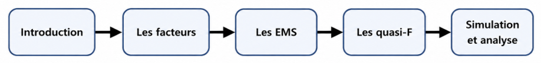
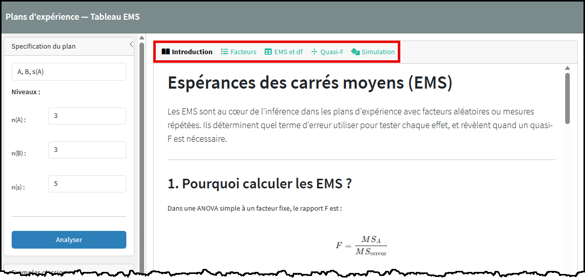
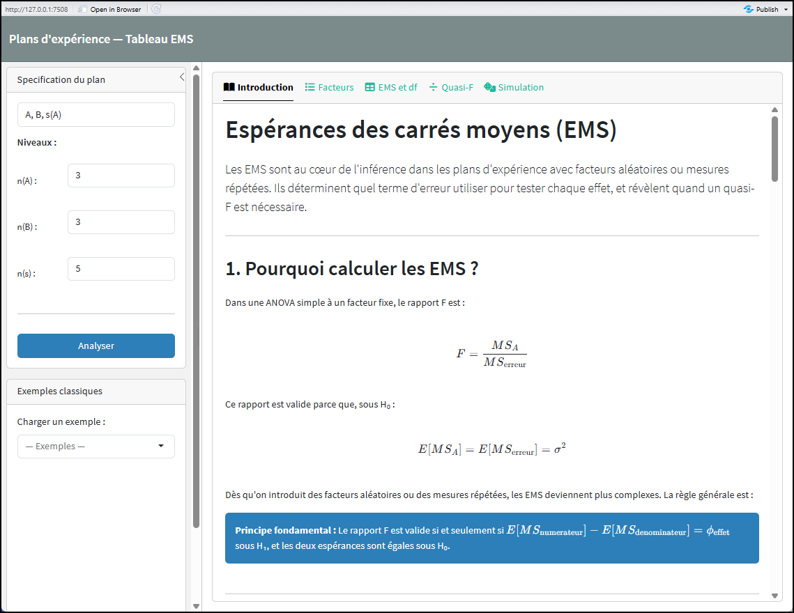

## Pourquoi les plans d'expérience?

Un enseignant affirme qu'une nouvelle méthode pédagogique améliore les résultats de ses étudiants. Après un semestre, la moyenne obtenue par son groupe est effectivement plus élevée que celle observée les années précédentes.

Peut-on conclure que cette méthode est réellement responsable de cette amélioration? Les étudiants étaient-ils comparables? Les examens présentaient-ils le même niveau de difficulté? D'autres changements sont-ils survenus durant la session? À partir de cette seule observation, il est impossible de répondre avec certitude à ces questions.

Les plans d'expérience ont précisément été développés pour résoudre ce type de problème. Leur objectif est de permettre au chercheur de distinguer les effets réellement attribuables aux traitements étudiés de toutes les autres sources de variation susceptibles d'influencer les résultats.

Toute expérimentation repose sur cette idée fondamentale. Les différences observées entre deux groupes peuvent provenir du traitement lui-même, mais aussi des différences naturelles entre les sujets, des erreurs de mesure, des fluctuations aléatoires ou encore d'autres facteurs qui n'ont pas été pris en considération. Concevoir un bon plan d'expérience consiste donc à organiser la collecte des données de manière à isoler ces différentes sources de variation.

::: {.callout-warning}
### Erreur fréquente

Observer une différence entre deux groupes ne permet pas, à lui seul, de conclure qu'un traitement est efficace.

Toute différence observée peut résulter de nombreuses causes. Le rôle du plan d'expérience consiste précisément à déterminer si cette différence peut raisonnablement être attribuée au traitement étudié.
:::

::: {.callout-tip}
### Activité 1.1 — Réfléchir avant de poursuivre

Pensez à une étude dont vous avez récemment entendu parler dans les médias ou dans votre domaine d'études.

Quels facteurs, autres que le traitement étudié, pourraient avoir influencé les résultats?

Essayez d'en identifier au moins trois avant de poursuivre votre lecture.
:::

## Comprendre avant d'appliquer

De nombreux ouvrages présentent les plans d'expérience comme une succession de modèles particuliers : plans complètement randomisés, plans en blocs, plans factoriels, mesures répétées, plans mixtes ou modèles imbriqués. Cette approche est efficace lorsqu'on souhaite appliquer rapidement une méthode particulière, mais elle laisse souvent croire qu'il faut mémoriser une longue série de techniques indépendantes.

Le présent manuel adopte une perspective différente. Plutôt que d'apprendre une collection de modèles, nous chercherons à comprendre les quelques principes qui les gouvernent tous. Une fois ces principes assimilés, les différents plans apparaissent comme des variantes d'une même logique plutôt que comme une succession de recettes.

Notre objectif ne sera donc jamais de mémoriser des tableaux ou des formules. Nous chercherons d'abord à comprendre pourquoi ces résultats prennent la forme qu'ils prennent. Les calculs deviendront alors beaucoup plus naturels et les modèles complexes beaucoup plus faciles à interpréter.

::: {.callout-note}
### À retenir

Dans cet ouvrage, les formules ne constituent jamais le point de départ du raisonnement.

Nous chercherons toujours à comprendre une idée avant d'en présenter la traduction mathématique.
:::

## Une démarche fondée sur la compréhension

Tout au long de ce manuel, nous suivrons toujours la même démarche. Nous commencerons par décrire le plan expérimental et identifier les facteurs qui le composent. Cette description déterminera entièrement la structure statistique du modèle.

Nous construirons ensuite les espérances des carrés moyens (EMS), qui constituent le fondement théorique de l'analyse de la variance. Les EMS permettront de déterminer les termes d'erreur appropriés et de justifier les différents rapports $F$. Lorsque cette démarche ne conduira pas à un terme d'erreur pur, nous verrons comment construire un quasi-$F$.

Enfin, nous vérifierons l'ensemble de ces raisonnements au moyen de données simulées. Cette dernière étape permettra de relier directement la théorie aux résultats observés lors d'une analyse. Les différentes étapes de cette démarche sont résumées à la figure suivante.

{#fig-demarche fig-align="center" width="95%"}

## Le rôle de l'application *ExpDesign*

Ce manuel a été conçu parallèlement à l'application [**ExpDesign**](https://shiny.dcstats.org/ExpDesign), et les deux ressources ont été pensées pour être utilisées conjointement. Le manuel développe les concepts, justifie les méthodes et présente les fondements théoriques nécessaires à leur compréhension. L'application, pour sa part, permet d'explorer ces mêmes concepts de façon interactive.

L'application ne se limite pas à effectuer des calculs. Elle guide progressivement l'utilisateur dans la description du plan expérimental, l'identification des facteurs, la construction des carrés moyens attendus, le choix du terme d'erreur et, lorsque cela est nécessaire, la construction d'un quasi-$F$. Les données peuvent ensuite être simulées afin de vérifier que les analyses retrouvent effectivement les effets introduits dans la population.

Cette complémentarité constitue l'un des objectifs principaux de l'ouvrage. Le lecteur pourra passer continuellement de la théorie à l'application, puis revenir au texte afin de consolider sa compréhension.

{#fig-interface fig-align="center" width="95%"}

::: {.callout-tip}
### Activité 1.2 — Découvrir l'application

Ouvrez l'application **ExpDesign**.

Sans chercher à comprendre immédiatement tous les détails, parcourez simplement les différents onglets.

Essayez de répondre à cette question :

> Quelle semble être la logique générale de l'application?

Vous constaterez progressivement que son organisation reproduit exactement celle du manuel.
:::

## Organisation de l'ouvrage

Les chapitres qui suivent reprennent exactement cette progression. Le deuxième chapitre est consacré à la description des facteurs expérimentaux. Le troisième présente les espérances des carrés moyens et explique leur construction. Le quatrième montre comment déterminer les termes d'erreur et construire un quasi-$F$ lorsqu'aucun terme d'erreur pur n'existe. Enfin, le dernier chapitre met en œuvre l'ensemble de ces concepts au moyen de simulations et d'analyses complètes.

L'objectif n'est pas seulement de savoir appliquer une analyse de la variance, mais de comprendre pourquoi chaque étape est nécessaire et comment elle découle directement de la structure du plan expérimental.

{#fig-ecran-principal fig-align="center" width="95%"}

::: {.callout-note}
### Avant de poursuivre...

Le chapitre suivant montrera que toute analyse d'un plan d'expérience commence par une description rigoureuse des facteurs qui le composent. Cette étape paraît simple, mais elle détermine toute la structure des analyses qui suivront.
:::

## L'essentiel à retenir

::: {.callout-important}
### Les idées essentielles

- Les plans d'expérience permettent de distinguer les effets réels des autres sources de variation.
- Toute analyse expérimentale débute par une description rigoureuse du plan.
- Les EMS constituent le fondement théorique des rapports $F$.
- Les quasi-$F$ deviennent nécessaires lorsqu'aucun terme d'erreur pur n'est disponible.
- L'application [**ExpDesign**](https://shiny.dcstats.org/ExpDesign) reproduit chacune des étapes étudiées dans ce manuel.
:::

::: {.callout-tip}
### En une phrase

**Un plan d'expérience permet de distinguer les effets réels des nombreuses sources de variation présentes dans les observations.**
:::