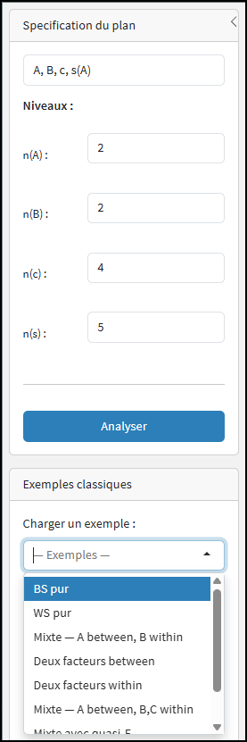
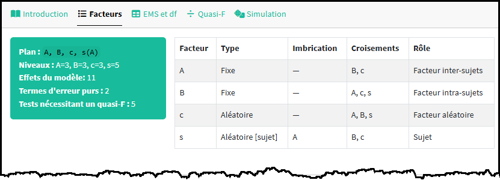
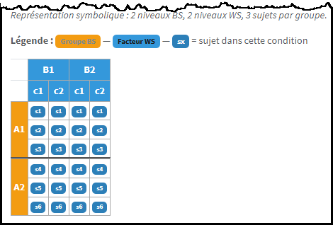

## Ce que vous apprendrez

À la fin de ce chapitre, vous serez capable de lire la notation d'un plan expérimental, d'identifier les différents types de facteurs qui le composent et de comprendre comment leur organisation détermine la structure de toute l'analyse statistique.

## Pourquoi décrire les facteurs?

Une chercheuse souhaite comparer trois méthodes pédagogiques. Les étudiants proviennent de quatre écoles différentes et sont évalués à trois reprises au cours de la session.

Combien de facteurs comporte cette étude? Lesquels représentent les traitements? Les écoles doivent-elles être considérées comme fixes ou aléatoires? Les trois évaluations correspondent-elles à des mesures répétées?

Toutes ces questions doivent être résolues avant même de recueillir la première donnée. En effet, la description du plan expérimental détermine entièrement la structure du modèle statistique, les espérances des carrés moyens, les termes d'erreur et les tests qui pourront être réalisés.

Dans les plans les plus simples, cette description paraît presque évidente. Dès que plusieurs facteurs interviennent simultanément ou que certains d'entre eux sont aléatoires, imbriqués ou mesurés à répétition, la structure du modèle devient rapidement plus complexe. Une description rigoureuse du plan devient alors indispensable.

L'application [**ExpDesign**](https://shiny.dcstats.org/ExpDesign) accorde une place importante à la description du plan expérimental. Avant d'effectuer le moindre calcul, elle analyse automatiquement la notation fournie et identifie les facteurs qui composent le modèle. Cette étape constitue le point de départ de toutes les analyses subséquentes.

Comme l'illustre la @fig-saisie-plan, la description d'un plan expérimental s'effectue entièrement à partir de la barre latérale. Le chercheur commence par saisir la notation du plan, précise ensuite le nombre de niveaux de chaque facteur et peut, au besoin, sélectionner un exemple classique afin de se familiariser avec une structure expérimentale particulière.

{#fig-saisie-plan fig-align="center" width="38%"}

La première étape consiste à décrire le plan au moyen d'une notation compacte, par exemple `A, B, c, s(A)`. Cette notation peut sembler abstraite au premier abord, mais elle remplace simplement les noms des facteurs réels afin de mettre l'accent sur la structure du plan plutôt que sur son contexte d'application.

Dans une étude concrète, `A` pourrait représenter une méthode pédagogique, `B` le sexe des participants, `c` un ensemble d'écoles choisies au hasard et `s` les sujets eux-mêmes. La notation `s(A)` indique que chaque sujet appartient à un seul niveau du facteur `A`; les sujets sont donc imbriqués dans ce facteur. En revanche, ils ne sont pas imbriqués dans les facteurs `B` et `c`. Chaque sujet est ainsi observé dans toutes les combinaisons de niveaux de ces deux facteurs, qui correspondent alors à des facteurs intra-sujets (mesures répétées).

Le tableau suivant illustre cette correspondance.

| Facteur réel | Notation |
|--------------|:--------:|
| Méthode pédagogique | **A** |
| Sexe | **B** |
| Écoles (échantillonnées au hasard) | **c** |
| Sujets | **s** |
| Sujets imbriqués dans la méthode pédagogique | **s(A)** |

Cette convention sera utilisée dans tout le reste de l'ouvrage. Une fois que l'on maîtrise cette notation, il devient beaucoup plus facile de reconnaître la structure d'un plan expérimental, quelle que soit la nature des facteurs étudiés.

À ce stade, il importe ensuite de préciser le nombre de niveaux de chacun des facteurs. Ces valeurs déterminent la structure du plan expérimental et seront utilisées par la suite pour construire les espérances des carrés moyens, calculer les degrés de liberté et simuler les données. Elles peuvent être modifiées librement afin d'explorer différentes configurations expérimentales.
A ce stade, il importe de préciser le nombre de niveaux de chacun des facteurs. Ces valeurs déterminent la structure du plan expérimental et seront utilisées par la suite pour construire les espérances des carrés moyens, calculer les degrés de liberté et simuler les données. Elles peuvent être modifiées librement afin d'explorer différentes configurations expérimentales.

Pour faciliter la découverte des principaux types de plans d'expérience, l'application propose également une série d'**exemples classiques**. La sélection d'un exemple remplit automatiquement la description du plan ainsi que les nombres de niveaux correspondants. Cette fonctionnalité permet de se familiariser rapidement avec les différentes structures expérimentales avant de construire ses propres modèles.

Dès lors, on peut lancer l'analyse en cliquant le bouton **Analyser**, et passer à l'onglet **Facteurs**.

::: {.callout-note}
### Conseil

Si vous utilisez l'application pour la première fois, commencez par explorer les exemples proposés. Ils illustrent les principaux types de plans d'expérience et constituent une excellente façon d'apprendre à reconnaître leur notation et leur structure avant de créer vos propres plans.
:::

::: {.callout-tip}
### Activité 2.1 — Décrire un plan

Ouvrez l'application et saisissez le plan suivant :

`A, B, s(A)`

Avant de cliquer sur **Analyser**, essayez de répondre aux questions suivantes.

- Combien de facteurs comporte le plan?
- Quel facteur représente les sujets?
- Quels facteurs seront fixes?
- Le plan comporte-t-il des mesures répétées?

Vous reviendrez sur ces questions au fil du chapitre.
:::

::: {.callout-note}
### Convention utilisée dans ce manuel

Les plans d'expérience sont représentés à l'aide d'une notation concise.

- Les facteurs fixes sont notés **A**, **B**, **C**, ...
- Les facteurs aléatoires sont notés **c**, **d**, ...
- La lettre **s** désigne toujours les sujets.
- Une notation comme **s(A)** signifie que les sujets sont imbriqués dans le facteur **A**.

Ces conventions seront utilisées dans tout le reste de l'ouvrage.
:::

## Qu'est-ce qu'un facteur?

Un facteur est une caractéristique dont les niveaux définissent les conditions expérimentales. Chaque observation appartient à un niveau de chacun des facteurs présents dans le plan. L'ensemble de ces niveaux détermine les conditions dans lesquelles la mesure est effectuée.

Le facteur peut représenter un traitement appliqué aux sujets, une méthode d'enseignement, une dose d'un médicament, un moment de mesure, un laboratoire, un évaluateur ou toute autre source de variation que le chercheur souhaite prendre en considération. La variable dépendante est ensuite observée dans chacune des combinaisons de niveaux définies par ces facteurs.

Dans ce manuel, chaque facteur est représenté par une lettre majuscule, conformément à la notation classique des plans d'expérience. Les sujets sont désignés par la lettre *s*, utilisée comme facteur aléatoire particulier représentant la variabilité entre les unités expérimentales.

## Les facteurs fixes

Un facteur est dit **fixe** lorsque les niveaux étudiés sont précisément ceux qui intéressent le chercheur. Les conclusions porteront exclusivement sur ces niveaux et ne visent pas une population plus vaste de modalités possibles.

Considérons, par exemple, une étude comparant trois méthodes pédagogiques particulières. Si ces trois méthodes constituent exactement celles que le chercheur souhaite comparer, le facteur *Méthode* est un facteur fixe. Les différences observées concernent uniquement ces trois modalités et ne permettent pas de généraliser directement les résultats à d'autres méthodes qui n'ont pas été étudiées.

Les facteurs fixes constituent la situation la plus fréquente en expérimentation. Ils donnent naissance aux effets principaux et aux interactions qui sont généralement au cœur des hypothèses de recherche.

## Les facteurs aléatoires

Un facteur est dit **aléatoire** lorsque les niveaux observés sont considérés comme un échantillon prélevé dans une population beaucoup plus vaste de niveaux possibles. Dans ce cas, le chercheur ne s'intéresse pas aux niveaux eux-mêmes, mais à la variabilité qu'ils représentent.

Les sujets constituent le meilleur exemple d'un facteur aléatoire. Les participants inclus dans une étude ne représentent généralement qu'un échantillon de la population visée. Les conclusions ne portent donc pas sur ces individus particuliers, mais sur la population dont ils sont issus. De la même façon, des écoles, des hôpitaux, des laboratoires ou des observateurs peuvent être traités comme des facteurs aléatoires lorsqu'ils sont sélectionnés parmi un ensemble plus vaste.

La distinction entre facteurs fixes et facteurs aléatoires joue un rôle fondamental dans la construction des carrés moyens attendus. Les effets fixes introduisent des composantes systématiques dans les EMS, alors que les facteurs aléatoires contribuent principalement aux composantes de variance.

::: {.callout-warning}
### Erreur fréquente

Un facteur n'est pas aléatoire parce qu'il possède beaucoup de niveaux.

Il est aléatoire parce que les niveaux observés sont considérés comme un échantillon provenant d'une population plus vaste.
:::

::: {.callout-tip}
### Activité 2.2 — Facteur fixe ou facteur aléatoire?

Pour chacun des exemples suivants, indiquez si le facteur devrait être considéré comme fixe ou aléatoire.

- Trois méthodes pédagogiques choisies par le chercheur.
- Dix écoles sélectionnées au hasard dans une province.
- Deux doses d'un médicament.
- Vingt psychologues choisis parmi tous ceux d'un réseau hospitalier.

Justifiez chacune de vos réponses.
:::

## Facteurs croisés et facteurs imbriqués

Deux facteurs sont dits **croisés** lorsque tous les niveaux de l'un apparaissent avec tous les niveaux de l'autre. Un plan factoriel classique, dans lequel chaque méthode d'enseignement est appliquée à chacun des niveaux d'un second facteur, constitue un exemple de croisement complet.

À l'inverse, un facteur est **imbriqué** dans un autre lorsque ses niveaux n'existent qu'à l'intérieur d'un seul niveau de ce dernier. Les classes d'une école, par exemple, sont imbriquées dans les écoles puisqu'une même classe n'appartient jamais à deux écoles différentes. Cette distinction est essentielle, car les facteurs imbriqués et les facteurs croisés produisent des structures d'EMS très différentes.

Dans la notation utilisée par l'application, un facteur imbriqué est indiqué entre parenthèses. Ainsi, l'expression *s(A)* signifie que les sujets sont imbriqués dans les niveaux du facteur *A*. 

Comme le montre la @fig-facteurs, la portion supérieure de l'onglet **Facteurs** résume automatiquement les principales caractéristiques du plan expérimental. Elle présente notamment la description du plan, le nombre de niveaux de chaque facteur, le nombre d'effets du modèle ainsi que le nombre de termes d'erreur et de tests nécessitant un quasi-$F$. Le tableau qui l'accompagne décrit ensuite chacun des facteurs selon son type, ses relations d'imbrication ou de croisement et son rôle dans le plan. Cette description constitue le point de départ de toute l'analyse qui suivra.

{#fig-facteurs fig-align="center" width="90%"}

Dans cet exemple, le plan analysé est `A, B, c, s(A)`. Les facteurs **A** et **B** sont des facteurs fixes, tandis que **c** est un facteur aléatoire. Le facteur **A** est identifié comme un facteur **inter-sujets**, car les sujets sont imbriqués dans ce facteur (`s(A)`) : chaque sujet appartient à un seul niveau de **A**. À l'inverse, les facteurs **B** et **c** sont des facteurs **intra-sujets**, puisque les mêmes sujets sont observés à chacun de leurs niveaux. Chaque sujet est donc évalué pour toutes les combinaisons des niveaux de **B** et de **c**.

Cette distinction entre facteurs inter-sujets et intra-sujets est fondamentale. Elle déterminera directement la structure des espérances des carrés moyens, le choix des termes d'erreur et, dans certains cas, la nécessité de recourir à un quasi-$F$.

## Les mesures répétées

Dans un plan à mesures répétées, la même variable dépendante est mesurée plusieurs fois chez chaque sujet, soit à différents moments, soit dans différentes conditions expérimentales. Les facteurs dont tous les niveaux sont observés chez les mêmes sujets sont appelés **facteurs intra-sujets**.

Les mesures répétées introduisent une corrélation entre les observations provenant d'un même individu. Cette dépendance modifie la structure du modèle et entraîne l'apparition de nouveaux termes d'erreur, souvent représentés par des interactions impliquant les sujets.

Les plans comportant des mesures répétées exigent donc une attention particulière lors de la construction des EMS et du choix des rapports $F$.

Pour compléter cette description, l'application construit automatiquement une représentation graphique du plan expérimental. Celle-ci permet de visualiser immédiatement l'organisation des observations et facilite la compréhension des plans comportant plusieurs facteurs.

{#fig-kirk fig-align="center" width="70%"}
  
La répétition des mêmes sujets dans plusieurs cellules constitue l’élément essentiel de cette représentation. Par exemple, le sujet `s1` apparaît sous chacune des combinaisons des niveaux de **B** et de **c**. Cela signifie que ce même sujet est observé à répétition dans toutes ces conditions. Les facteurs **B** et **c** sont donc des facteurs intra-sujets, tandis que **A** demeure un facteur inter-sujets puisque des groupes de sujets différents sont associés à ses niveaux. La simple répétition des identifiants de sujets permet ainsi de reconnaître immédiatement quels facteurs sont intra-sujets et lesquels sont inter-sujets.

::: {.callout-note}
### Pourquoi cette représentation?

La notation d'un plan expérimental demeure abstraite pour plusieurs étudiants. La représentation graphique permet de visualiser immédiatement comment les observations sont réparties entre les facteurs et les sujets. Elle constitue un excellent moyen de vérifier que le plan a été correctement interprété.
:::

::: {.callout-tip}
### Activité 2.3 — Vérifier votre lecture

Analysez successivement les plans suivants.

`A, s(A)`

`A, B, s(A)`

`A, B, c, s(A)`

Pour chacun d'eux, essayez de répondre aux questions suivantes avant de consulter les résultats de l'application.

- Combien de facteurs comporte le plan?
- Lesquels sont fixes?
- Lesquels sont aléatoires?
- Quels facteurs sont croisés ou imbriqués?
- Combien d'effets le modèle devrait-il produire?

Utilisez ensuite le résumé et le tableau des facteurs pour vérifier chacune de vos réponses.
:::

## Ce qu'il faut retenir de la description d'un plan

À ce stade, aucune donnée n'a encore été générée et aucun calcul statistique n'a été effectué. Pourtant, l'essentiel du travail est déjà accompli. Une fois les facteurs correctement identifiés, leur nature précisée et leurs relations établies, toute la structure du modèle est déterminée.

Les chapitres suivants ne feront qu'exploiter cette description. Les espérances des carrés moyens, les termes d'erreur, les rapports $F$ et, lorsque cela sera nécessaire, les quasi-$F$ découleront directement de l'organisation du plan expérimental. C'est pourquoi il est essentiel d'acquérir dès maintenant le réflexe de lire un plan avant de chercher à l'analyser.

## Ce chapitre en une minute

Avant d'entreprendre toute analyse, prenez l'habitude de répondre aux cinq questions suivantes.

1. Quels sont les facteurs?
2. Lesquels sont fixes?
3. Lesquels sont aléatoires?
4. Quels facteurs sont croisés ou imbriqués?
5. Le plan comporte-t-il des mesures répétées?

Ces cinq questions constituent une grille de lecture que vous pourrez réutiliser dans tous les chapitres suivants.

## L'essentiel à retenir

::: {.callout-important}
### Les idées essentielles

- Les facteurs définissent entièrement la structure d'un plan expérimental.
- Un facteur peut être fixe ou aléatoire selon l'objectif de l'étude.
- Les facteurs peuvent être croisés ou imbriqués.
- Les mesures répétées modifient la structure du modèle et les termes d'erreur associés.
- Une description correcte des facteurs constitue le point de départ de toute l'analyse.

:::

::: {.callout-tip}
### En une phrase

**Bien décrire un plan expérimental, c'est déjà préparer correctement toute l'analyse qui suivra.**
:::