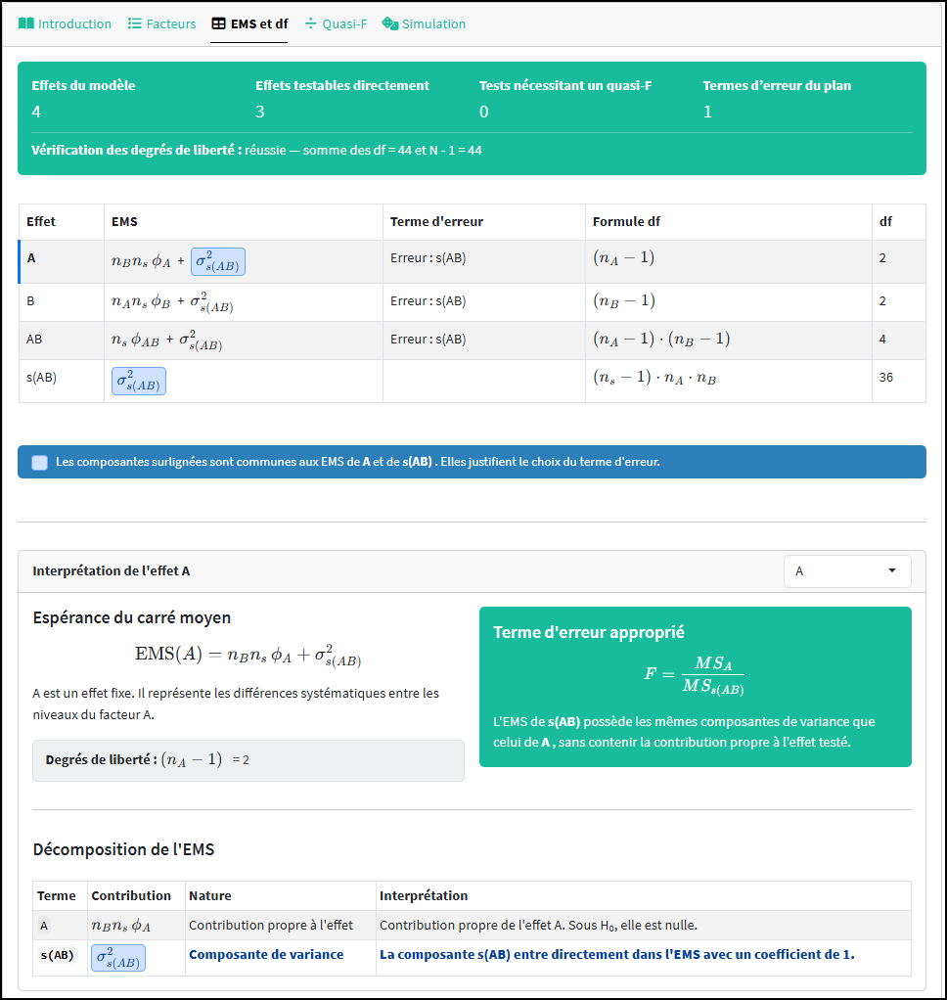
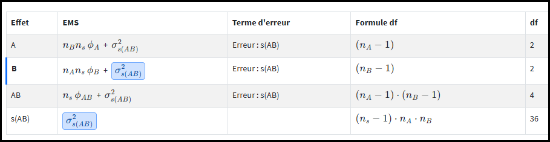
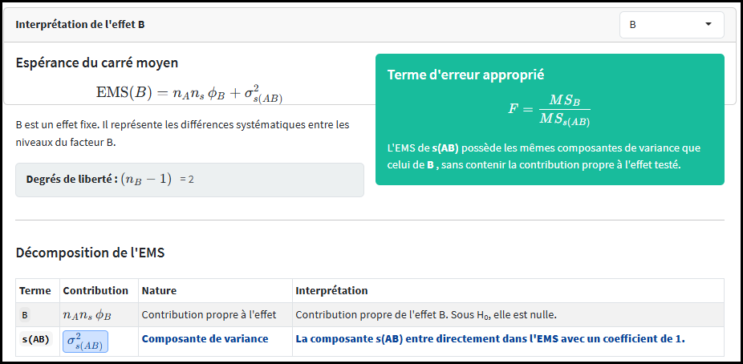

## Ce que vous apprendrez

À la fin de ce chapitre, vous comprendrez le rôle des espérances des carrés moyens (EMS) dans l'analyse de la variance. Vous saurez interpréter les composantes d'un EMS, comprendre comment elles sont construites et, surtout, choisir le terme d'erreur approprié pour tester chacun des effets d'un modèle.

## Pourquoi s'intéresser aux EMS?

Au chapitre précédent, nous avons appris à décrire la structure d'un plan expérimental. Nous savons maintenant reconnaître les facteurs fixes et aléatoires, les facteurs inter-sujets et intra-sujets, ainsi que les relations d'imbrication ou de croisement qui existent entre eux.

Une question essentielle demeure toutefois sans réponse. Une fois les données recueillies et les carrés moyens calculés, comment savoir quel carré moyen doit servir de terme d'erreur pour tester un effet donné?

Dans une ANOVA à un facteur, la réponse est simple : tous les effets sont comparés au carré moyen résiduel. Dès que plusieurs facteurs, des effets aléatoires ou des mesures répétées interviennent, cette règle ne s'applique plus. Chaque effet doit être comparé au terme d'erreur qui lui convient.

Les espérances des carrés moyens (EMS) ont précisément pour objectif de répondre à cette question. Elles décrivent les différentes sources de variation présentes dans chacun des carrés moyens et permettent d'identifier le terme d'erreur approprié pour construire un test $F$ valide.

L'application [**ExpDesign**](https://shiny.dcstats.org/ExpDesign) automatise entièrement cette démarche. Plutôt que de mémoriser les règles propres à chaque type de plan, l'utilisateur apprend à interpréter les EMS et à comprendre le raisonnement qui conduit au choix du terme d'erreur.

## Un premier exemple

Avant d'étudier la construction générale des EMS, considérons un exemple très simple.

Supposons que le plan expérimental soit

```text
A, B, s(AB)
```

où **A** et **B** sont deux facteurs fixes et où les sujets sont imbriqués dans chacune des combinaisons de leurs niveaux.

En spécifiant ce plan d'expérience dans l'onglet **Facteurs** de l'applicatin, on obtient les EMS suivants dans l'onglet **EMS et df**:

| Effet | EMS |
|:------|:----|
| A | $n_Bn_s\phi_A + n_s\sigma^2_{AB} + \sigma^2_{s(AB)}$ |
| B | $n_An_s\phi_B + n_s\sigma^2_{AB} + \sigma^2_{s(AB)}$ |
| AB | $n_s\sigma^2_{AB} + \sigma^2_{s(AB)}$ |
| s(AB) | $\sigma^2_{s(AB)}$ |

À première vue, ces expressions peuvent sembler impressionnantes. Pourtant, leur interprétation repose sur une idée très simple. Il n'est pas nécessaire, dans un premier temps, de comprendre la signification exacte de chacun des symboles. Il suffit d'observer que certains termes apparaissent dans plusieurs EMS, alors que d'autres sont propres à un effet particulier.

Supposons maintenant que l'on souhaite tester l'effet principal **A**.

L'espérance du carré moyen associée à **A** contient deux composantes :

- le terme $\phi_A$, qui représente l'effet systématique du facteur **A**;
- la composante de variance $\sigma^2_{s(AB)}$, qui représente la variabilité résiduelle entre les sujets.

Pour construire un test $F$, il faut comparer $MS_A$ à un carré moyen contenant **exactement les mêmes composantes de variance**, mais **sans** le terme représentant l'effet que l'on souhaite tester.

Dans ce plan, le carré moyen des sujets imbriqués dans les combinaisons de **A** et **B**, noté $MS_{s(AB)}$, possède précisément cette propriété. Son EMS contient uniquement la composante de variance $\sigma^2_{s(AB)}$, commune à l'EMS de **A**.

Le choix du terme d'erreur repose d'abord sur les **espérances** des carrés moyens, et non sur les carrés moyens observés. Autrement dit, les EMS permettent de raisonner sur un modèle théorique, alors que le test $F$ est calculé à partir des données observées. Les premiers justifient la construction du second.

Dans notre exemple,

$$
E(MS_A)=n_Bn_s\phi_A+\sigma^2_{s(AB)}
$$

et

$$
E(MS_{s(AB)})=\sigma^2_{s(AB)}.
$$

Le rapport des espérances des carrés moyens s'écrit donc

$$
E(F)=
\frac{E(MS_A)}
     {E(MS_{s(AB)})}
=
\frac{n_Bn_s\phi_A+\sigma^2_{s(AB)}}
     {\sigma^2_{s(AB)}}.
$$

Sous l'hypothèse nulle ($H_0:\phi_A=0$), ce rapport devient

$$
E(F)=1.
$$

Les espérances des carrés moyens étant inconnues, elles sont estimées à l'aide des carrés moyens observés. Le rapport de test devient alors

$$
F=
\frac{MS_A}
     {MS_{s(AB)}}.
$$

Autrement dit, les EMS ne servent pas directement à calculer la statistique $F$. Ils permettent de **justifier** le choix du dénominateur en montrant que, sous l'hypothèse nulle, les deux carrés moyens possèdent la même espérance.

Les deux carrés moyens partagent ainsi la même composante de variance. Sous l'hypothèse nulle ($H_0:\phi_A=0$), leur rapport possède une espérance égale à 1 et suit une loi $F$. On peut donc utiliser ce rapport pour tester l'existence d'un effet du facteur **A**.

Le même raisonnement permettra de déterminer le terme d'erreur approprié pour chacun des autres effets du modèle.

En résumé, les EMS ne servent pas à calculer un test $F$; ils servent à démontrer que le rapport des carrés moyens observés constitue une estimation valide du rapport théorique des espérances sous l'hypothèse nulle.

::: {.callout-important}
### Le principe fondamental

Les espérances des carrés moyens ne sont pas construites pour être mémorisées.

Elles servent à répondre à une seule question :

> **Quel carré moyen possède exactement les mêmes composantes que celui de l'effet étudié, à l'exception de l'effet lui-même?**

Ce carré moyen constitue le terme d'erreur du test $F$.
:::

Cette idée constitue le fil conducteur de tout le chapitre. Dans les sections suivantes, nous verrons comment les EMS sont construits, comment interpréter leurs différentes composantes et comment l'application utilise automatiquement cette information pour sélectionner le terme d'erreur approprié.

## Les composantes d'un EMS

L'exemple précédent montre qu'un EMS est constitué de plusieurs termes représentant différentes sources de variation. Chacun de ces termes possède une signification bien précise. Une fois ces composantes comprises, la lecture d'un EMS devient beaucoup plus intuitive.

On retrouve essentiellement trois catégories de termes.

| Terme | Signification |
|:------|:--------------|
| $\phi$ | Contribution de l'effet étudié à l'espérance du carré moyen |
| $\sigma^2$ | Composante de variance associée à une source de variation aléatoire |
| Coefficient ($n_A$, $n_B$, $n_s$, ...) | Facteur de pondération dépendant de la structure du plan expérimental |

Le terme $\phi$ représente la contribution de l'effet étudié à l'espérance du carré moyen. Lorsque l'hypothèse nulle est vraie, cette contribution disparaît et l'EMS ne contient plus que des composantes de variance.

Les termes contenant $\sigma^2$ représentent les différentes composantes de variance présentes dans le modèle. Selon le plan expérimental, elles peuvent être associées à des facteurs aléatoires, à des interactions aléatoires ou à la variabilité résiduelle. Contrairement au terme $\phi$, ces composantes subsistent sous l'hypothèse nulle.

Les coefficients ($n_A$, $n_B$, $n_s$, etc.) dépendent uniquement de la structure du plan expérimental. Ils indiquent comment les différentes composantes de variance contribuent à l'espérance de chaque carré moyen.

Les coefficients ($n_A$, $n_B$, $n_s$, etc.) indiquent simplement combien d'observations contribuent à chacune de ces composantes. Ils dépendent directement du plan expérimental et des nombres de niveaux spécifiés dans l'application.

::: {.callout-note}
### Comment lire un EMS

Commencez toujours par repérer les termes $\phi$, puis les composantes de variance ($\sigma^2$). Les coefficients ($n_A$, $n_B$, $n_s$, ...) ne deviennent importants qu'après avoir identifié les différentes sources de variation présentes dans l'EMS.
:::

::: {.callout-note}
### À retenir

Dans la plupart des cas, il n'est pas nécessaire de retenir les coefficients par cœur. Ce qui importe est de reconnaître **quelles composantes de variance apparaissent dans chaque EMS**.
:::

## Construire les EMS avec l'application

L'onglet **EMS et df** construit automatiquement les espérances des carrés moyens à partir de la description du plan expérimental.

{#fig-ems fig-align="center" width="95%"}

La @fig-ems présente l’ensemble des informations nécessaires à la construction des tests $F$. La partie supérieure résume la structure générale de l’analyse : nombre d’effets du modèle, nombre d’effets testables directement, nombre de tests nécessitant un quasi-$F$, nombre de termes d’erreur et vérification des degrés de liberté.

Le tableau central présente ensuite, pour chaque effet, son EMS, le terme d’erreur retenu et les degrés de liberté correspondants. Lorsque l’effet sélectionné possède un terme d’erreur pur, les composantes de variance communes aux deux EMS sont mises en évidence. Cette mise en correspondance visuelle montre immédiatement pourquoi le carré moyen indiqué dans la colonne **Terme d’erreur** constitue le dénominateur approprié du rapport $F$.

Dans l’exemple présenté, l’effet **A** et son terme d’erreur **s(AB)** partagent la composante de variance $\sigma^2_{s(AB)}$. Le terme $\phi_A$ apparaît uniquement dans l’EMS de **A**, puisqu’il représente la contribution propre de l’effet testé. Sous l’hypothèse nulle, cette contribution disparaît et les deux carrés moyens possèdent alors la même espérance.

Enfin, la partie inférieure constitue une lecture guidée de l’effet sélectionné. Elle rappelle son EMS, présente le rapport $F$, justifie le choix du terme d’erreur, indique les degrés de liberté et décompose séparément chacune des composantes de l’EMS.

La décomposition de l’EMS est particulièrement utile lors des premiers apprentissages. Elle permet de distinguer les contributions propres aux effets étudiés, notées $\phi$, des composantes de variance, notées $\sigma^2$. En observant cette décomposition pour plusieurs effets d’un même modèle, on comprend progressivement pourquoi certains carrés moyens peuvent servir de termes d’erreur alors que d’autres ne conviennent pas.

Cette lecture guidée permet ainsi de comprendre le raisonnement ayant conduit au choix du terme d'erreur plutôt que de simplement en mémoriser le résultat.

::: {.callout-note}
### Comment lire cette figure

Commencez par sélectionner un effet. Repérez ensuite les composantes de variance mises en évidence dans son EMS et dans celui de son terme d’erreur. Le dénominateur approprié est celui qui reproduit les mêmes composantes de variance sans contenir la contribution propre à l’effet testé.
:::

## Lire un EMS

Lorsqu'on examine un EMS pour la première fois, il est tentant de lire la formule de gauche à droite comme une expression algébrique. Cette approche est rarement la plus efficace.

Il est préférable d'adopter une méthode de lecture systématique.

1. Identifier l'effet étudié.
2. Repérer les composantes de variance présentes.
3. Rechercher un autre EMS contenant exactement les mêmes composantes.
4. Vérifier que seul le terme représentant l'effet étudié disparaît.

Cette démarche est beaucoup plus simple qu'elle n'y paraît. Après quelques exemples, le choix du terme d'erreur devient presque immédiat.

Prenons de nouveau l'effet **A** du premier exemple.

$$
EMS(A)=n_Bn_s\phi_A+\sigma^2_{s(AB)}
$$

Cet EMS contient deux termes :

- $n_Bn_s\phi_A$, qui représente la contribution propre de l'effet fixe **A**;
- $\sigma^2_{s(AB)}$, qui représente la composante de variance associée aux sujets imbriqués dans les combinaisons de **A** et de **B**.

Sous l'hypothèse nulle $H_0:\phi_A=0$, la contribution propre de **A** disparaît. Il reste alors

$$
EMS(A\mid H_0)=\sigma^2_{s(AB)}.
$$

Il faut donc rechercher un carré moyen dont l'espérance contient cette même composante de variance, sans contenir la contribution $\phi_A$. Le terme associé aux sujets imbriqués dans les combinaisons de **A** et de **B** satisfait exactement cette condition :

$$
EMS\bigl(s(AB)\bigr)=\sigma^2_{s(AB)}.
$$

Le terme d'erreur approprié pour tester **A** est donc $s(AB)$, et le rapport de test est

$$
F=\frac{MS_A}{MS_{s(AB)}}.
$$

::: {.callout-important}
### Une bonne habitude

Lorsque vous examinez un EMS, ne commencez pas par les coefficients.

Commencez toujours par identifier les **composantes de variance** ($\sigma^2$). Ce sont elles qui déterminent le choix du terme d'erreur.
:::

::: {.callout-tip}
### Activité 3.1

Dans l'application, choisissez trois plans expérimentaux différents.

Pour chacun d'eux :

- identifiez l'EMS de l'effet **A**;
- repérez les composantes de variance présentes;
- essayez de deviner quel sera le terme d'erreur avant de consulter la colonne correspondante.

Vous constaterez rapidement que le raisonnement est toujours le même, quel que soit le plan étudié.
:::

## Les degrés de liberté

La construction d'un test $F$ ne dépend pas uniquement du choix du terme d'erreur. Il faut également connaître les degrés de liberté associés au numérateur et au dénominateur du rapport.

Dans les plans les plus simples, ces degrés de liberté sont obtenus directement à partir du plan expérimental. Dans les plans plus complexes, ils peuvent dépendre du terme d'erreur retenu et, dans certains cas, nécessiter une approximation. Nous reviendrons sur cette situation au chapitre suivant, consacré aux quasi-$F$.

L'onglet **EMS et df** présente automatiquement les degrés de liberté associés à chacun des effets du modèle.

{#fig-df fig-align="center" width="95%"}

L'application vérifie également que la somme des degrés de liberté de tous les effets est égale au nombre total d'observations moins un. Cette vérification constitue un excellent moyen de détecter rapidement une erreur dans la description du plan expérimental.

## Une lecture guidée des EMS

L'application ne se limite pas à afficher les EMS. Pour chacun des effets, elle propose également une interprétation détaillée du raisonnement conduisant au choix du terme d'erreur.

{#fig-lecture fig-align="center" width="95%"}

Cette section constitue probablement la partie la plus importante de l'application. Son objectif n'est pas de présenter un résultat, mais d'expliquer le raisonnement qui conduit à ce résultat.

Pour chaque effet, la lecture guidée répond successivement aux questions suivantes.

1. Quelles composantes apparaissent dans l'EMS?
2. Quel terme représente l'effet étudié?
3. Quel autre EMS possède exactement les mêmes composantes de variance?
4. Pourquoi ce carré moyen constitue-t-il le terme d'erreur approprié?
5. Quel rapport $F$ en résulte?

En suivant systématiquement cette démarche, il devient rapidement possible d'interpréter des EMS beaucoup plus complexes sans avoir à mémoriser des règles particulières.

::: {.callout-note}
### Une stratégie efficace

Ne cherchez pas à retenir les EMS.

Cherchez plutôt à comprendre pourquoi deux EMS peuvent être comparés dans un rapport $F$. Une fois ce principe assimilé, le choix du terme d'erreur devient presque automatique.
:::

## Vérifier le choix du terme d'erreur

Le terme d'erreur proposé par l'application ne doit jamais être considéré comme une simple réponse à apprendre par cœur. Il constitue l'aboutissement d'un raisonnement que l'utilisateur doit être capable de reproduire.

Une bonne façon de développer cette compétence consiste à masquer temporairement la colonne **Terme d'erreur** ou à essayer de prédire le résultat avant de consulter la lecture guidée.

Dans la plupart des plans expérimentaux, cette démarche devient rapidement naturelle. Les composantes de variance présentes dans les EMS permettent presque toujours d'anticiper correctement le terme d'erreur retenu.

::: {.callout-tip}
### Activité 3.2 — Trouver le terme d'erreur

Choisissez plusieurs plans expérimentaux dans l'application.

Pour chacun d'eux :

- choisissez un effet;
- identifiez les composantes de variance présentes dans son EMS;
- recherchez un autre EMS contenant exactement les mêmes composantes;
- prédisez le terme d'erreur;
- vérifiez ensuite votre réponse à l'aide de la lecture guidée.

Répétez l'exercice avec des plans de plus en plus complexes. Vous constaterez rapidement que le raisonnement reste essentiellement le même, quelle que soit la structure du modèle.
:::

## Vers les quasi-$F$

Dans la majorité des plans expérimentaux, un EMS possède un équivalent naturel pouvant servir de terme d'erreur. Il arrive toutefois que cette situation ne se produise pas.

Certains effets comportent des composantes de variance qui ne se retrouvent dans aucun autre EMS. Il devient alors impossible de construire directement un rapport $F$ valide.

C'est précisément dans cette situation qu'interviennent les **quasi-$F$**.

Le chapitre suivant montrera comment construire un terme d'erreur synthétique lorsque aucun carré moyen ne possède exactement les composantes de variance recherchées.

::: {.callout-tip}
### Activité 3.3 — Comparer plusieurs plans

Choisissez successivement les plans suivants dans l'application.

```text
A, s(A)

A, B, s(A)

A, B, c, s(A)
```

Pour chacun d'eux, observez :

- le nombre d'effets du modèle;
- les EMS construits automatiquement;
- les termes d'erreur retenus;
- les degrés de liberté;
- la présence éventuelle de tests nécessitant un quasi-$F$.

Cherchez à expliquer les différences observées avant de consulter la lecture guidée. Vous constaterez que, malgré l'augmentation de la complexité des plans, le principe de sélection des termes d'erreur demeure toujours le même.
:::

## Ce qu'il faut retenir des EMS

Les espérances des carrés moyens peuvent sembler impressionnantes lors d'un premier contact. Pourtant, elles ne constituent pas une collection de formules indépendantes. Elles décrivent simplement les différentes sources de variation présentes dans chacun des carrés moyens du modèle.

Leur véritable intérêt réside dans le choix du terme d'erreur. Deux EMS peuvent être comparés dans un rapport $F$ lorsqu'ils possèdent les mêmes composantes de variance et ne diffèrent que par la présence de l'effet étudié. Ce principe, simple en apparence, constitue le fondement de tous les tests réalisés dans l'analyse de la variance.

L'application [**ExpDesign**](https://shiny.dcstats.org/ExpDesign) automatise entièrement la construction des EMS, le calcul des degrés de liberté et le choix du terme d'erreur. Son objectif n'est toutefois pas de remplacer le raisonnement statistique, mais de le rendre plus transparent. La lecture guidée permet précisément de suivre chacune des étapes qui conduisent au choix d'un rapport $F$.

Dans la plupart des plans expérimentaux, cette démarche conduit directement à un terme d'erreur unique. Il existe cependant des situations où aucun EMS ne possède exactement les composantes recherchées. Le chapitre suivant montrera comment résoudre ce problème en construisant un **quasi-$F$**.

## Ce chapitre en une minute

Pour interpréter correctement un EMS, adoptez toujours la même démarche.

1. Identifier l'effet étudié.
2. Repérer les composantes de variance présentes dans son EMS.
3. Rechercher un autre EMS contenant exactement les mêmes composantes.
4. Vérifier que seul le terme représentant l'effet étudié disparaît.
5. Construire le rapport $F$ à partir de ces deux carrés moyens.

Cette méthode fonctionne pour la grande majorité des plans expérimentaux et constitue le principe fondamental de l'analyse de la variance.

## L'essentiel à retenir

::: {.callout-important}
### Les idées essentielles

- Un EMS décrit les sources de variation présentes dans un carré moyen.
- Les termes $\phi$ représentent les effets fixes, tandis que les termes $\sigma^2$ correspondent aux composantes de variance.
- Les coefficients dépendent uniquement de la structure du plan expérimental.
- Le terme d'erreur est choisi en comparant les composantes de variance des EMS.
- Les degrés de liberté complètent la construction du rapport $F$.
- Lorsqu'aucun EMS ne convient parfaitement, il faut recourir à un quasi-$F$.
:::

::: {.callout-tip}
### En une phrase

**Les EMS ne servent pas à mémoriser des formules; ils permettent de comprendre pourquoi un rapport $F$ est valide.**
:::