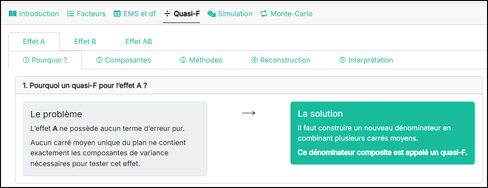
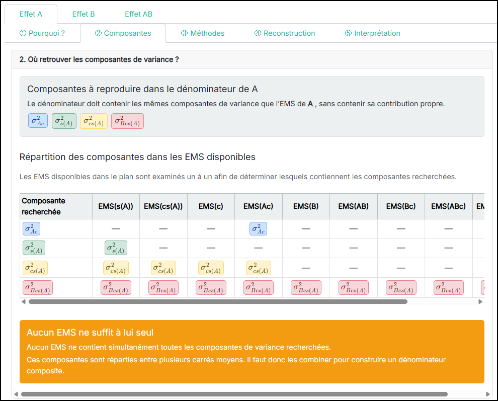
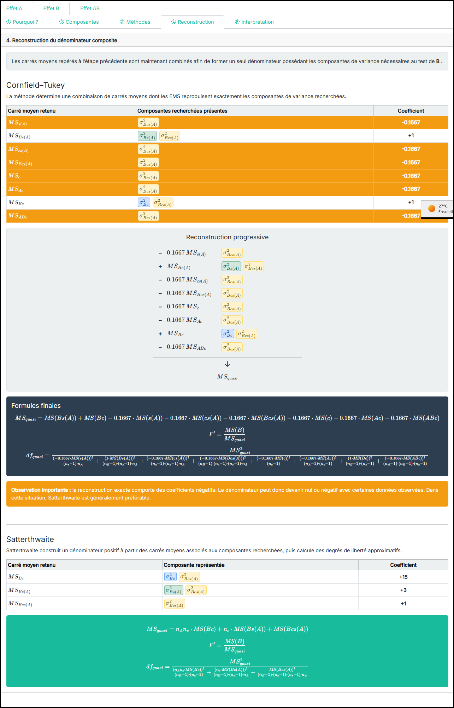

## Quand le terme d'erreur disparaît

Dans les chapitres précédents, nous avons vu que chaque effet d'un plan expérimental doit être comparé à un terme d'erreur approprié. Lorsque le numérateur et le dénominateur d'un rapport $F$ possèdent les mêmes composantes de variance, celles-ci s'annulent et le test statistique devient valide.

Cette situation est fréquente dans les plans les plus simples. Les carrés moyens disponibles fournissent naturellement les termes d'erreur nécessaires et la construction des rapports $F$ ne soulève aucune difficulté particulière.

Les plans expérimentaux plus complexes présentent toutefois une situation différente. Il arrive qu'aucun carré moyen du modèle ne possède exactement les composantes de variance recherchées. Le terme d'erreur idéal n'existe donc pas. C'est dans cette situation que les quasi-$F$ deviennent nécessaires.

::: {.callout-note}
### Dans l'application

Cette section correspond à l'onglet **Quasi-$F$**.
:::

::: {.callout-tip}
### Activité 4.1 — Le terme d'erreur existe-t-il?

Analysez un plan suffisamment complexe pour produire un quasi-$F$.

Avant d'ouvrir l'onglet **Quasi-$F$**, observez les EMS du chapitre précédent.

Essayez d'identifier un carré moyen qui pourrait servir de terme d'erreur pour l'effet étudié.

Existe-t-il réellement?
:::

## Pourquoi un quasi-$F$?

L'absence d'un terme d'erreur pur ne signifie pas qu'il devient impossible de tester un effet. Elle indique simplement que le dénominateur devra être construit plutôt que choisi.

L'idée consiste à combiner plusieurs carrés moyens afin de reconstituer les composantes de variance présentes dans l'EMS de l'effet étudié. Cette combinaison produit un nouveau carré moyen, appelé **quasi-carré moyen**, qui remplace le terme d'erreur inexistant.

Le quasi-$F$ constitue le prolongement naturel des EMS étudiés au chapitre précédent. Lorsqu'aucun carré moyen ne possède exactement les mêmes composantes de variance que l'effet testé sous $H_0$, il devient nécessaire de construire un dénominateur composite. L'application effectue automatiquement cette démarche et en présente toutes les étapes de façon progressive.

L'application identifie automatiquement chacun de ces effets et lui consacre un onglet distinct dans la section **Quasi-$F$**. Chaque onglet présente, étape par étape, la construction du test approprié, depuis l'identification du problème jusqu'à l'interprétation finale.

{#fig-qf-resume fig-align="center" width="95%"}

Le lecteur peut ainsi se concentrer uniquement sur les effets pour lesquels un quasi-$F$ est réellement nécessaire, sans avoir à déterminer lui-même quels termes d'erreur doivent être reconstruits.

{#fig-qf-resume fig-align="center" width="95%"}

La @fig-qf-resume montre immédiatement quels effets nécessitent un quasi-$F$. Le lecteur peut ainsi concentrer son attention sur les situations réellement problématiques.

## Les composantes à reproduire

Avant de construire un quasi-$F$, il faut déterminer quelles composantes de variance devront être reproduites dans le dénominateur.

L'étape suivante consiste à identifier les composantes de variance qui doivent apparaître dans le dénominateur du test. Sous l'hypothèse nulle, ce dénominateur doit posséder exactement les mêmes composantes de variance que l'EMS de l'effet étudié, à l'exception de la contribution propre de cet effet.

L'application rend cette étape entièrement explicite. Elle présente d'abord les composantes de variance recherchées, puis examine systématiquement les EMS disponibles afin de déterminer lesquels contiennent chacune de ces composantes.

{#fig-qf-sigma fig-align="center" width="95%"}

Cette représentation met en évidence l'origine même du problème. Les composantes de variance recherchées sont réparties entre plusieurs EMS : aucun carré moyen ne possède exactement la structure de variance nécessaire pour servir de dénominateur. Il devient donc indispensable de construire un **dénominateur composite** en combinant plusieurs carrés moyens.

{#fig-qf-sigma fig-align="center" width="95%"}
Le quasi-$F$ n'est donc pas construit à partir de formules arbitraires. Il résulte directement de la recherche d'une combinaison de carrés moyens possédant exactement la structure de variance exigée par la théorie des EMS.

::: {.callout-tip}
### Activité 4.2 — Observer les composantes

Choisissez un effet nécessitant un quasi-$F$.

Repérez les composantes de variance affichées par l'application.

Combien de carrés moyens semblent nécessaires pour les reproduire?
:::

## Deux méthodes de reconstruction

Une fois les composantes de variance identifiées, il reste à construire un dénominateur possédant exactement cette même structure. Deux approches sont alors possibles.

La première, proposée par **Cornfield et Tukey**, recherche une combinaison de carrés moyens dont l'espérance reproduit exactement les composantes de variance recherchées. Lorsque cette reconstruction est possible, elle fournit un quasi-$F$ théoriquement exact.

La seconde, proposée par **Satterthwaite**, construit un dénominateur positif à partir des mêmes carrés moyens, puis approxime les degrés de liberté associés à cette combinaison. Cette approche est particulièrement utile lorsque les coefficients de Cornfield-Tukey conduisent à des combinaisons comportant des coefficients négatifs.

L'application présente d'abord les principes généraux de ces deux méthodes avant d'en montrer la mise en œuvre détaillée.

{#fig-cornfield fig-align="center" width="95%"}

L'objectif de cette section est de comprendre le principe général des deux approches. Les développements mathématiques complets, la détermination des coefficients de Cornfield-Tukey, l'approximation de Satterthwaite ainsi qu'un exemple numérique détaillé sont présentés dans l'**annexe A**.

## Reconstruction détaillée du quasi-$F$

Les principes présentés précédemment prennent maintenant une forme concrète. Pour chaque effet nécessitant un quasi-$F$, l'application guide l'utilisateur à travers toutes les étapes de la reconstruction, depuis les EMS théoriques jusqu'à la décision statistique finale.

La démarche est organisée en cinq sous-onglets correspondant aux principales étapes du calcul :

1. identifier les carrés moyens utilisés;
2. reconstruire les combinaisons de Cornfield-Tukey;
3. calculer le quasi-$F$ observé;
4. approximer les degrés de liberté par la méthode de Satterthwaite;
5. interpréter le résultat obtenu.

{#fig-satterthwaite fig-align="center" width="80%"}

L'objectif n'est pas de demander au lecteur d'effectuer lui-même ces calculs, mais de rendre explicites toutes les étapes habituellement cachées par les logiciels statistiques. Cette présentation permet de comprendre l'origine du quasi-$F$ et des degrés de liberté qui lui sont associés.

::: {.callout-tip}
### Activité 4.3 — Comparer les deux méthodes

Observez les résultats obtenus avec Cornfield-Tukey et avec Satterthwaite.

Les deux méthodes produisent-elles toujours exactement le même dénominateur?

Dans quelles situations l'application recommande-t-elle de privilégier Satterthwaite?
:::

## Interpréter un quasi-$F$

Une fois construit, le quasi-$F$ s'interprète selon la même logique qu'un rapport $F$ classique. L'effet étudié est comparé à un dénominateur possédant, sous $H_0$, les mêmes composantes de variance que son carré moyen.

La différence essentielle réside dans l'origine de ce dénominateur. Celui-ci ne correspond pas à un carré moyen unique directement disponible dans le tableau d'analyse de la variance. Il est reconstruit à partir de plusieurs carrés moyens afin de reproduire la structure de variance requise par le test.

La question scientifique demeure donc inchangée : les différences associées à l'effet étudié dépassent-elles la variabilité attendue sous l'hypothèse nulle?

L'application résume ensuite la signification de la reconstruction obtenue et formule une recommandation pratique quant à la méthode à privilégier. Lorsque la solution de Cornfield-Tukey comporte des coefficients négatifs, l'approximation de Satterthwaite est généralement recommandée, car elle repose sur des combinaisons positives et fournit des degrés de liberté approximatifs adaptés au test.

{#fig-qf-interpretation fig-align="center" width="95%"}

Cette interprétation guidée montre que le quasi-$F$ repose sur le même principe qu'un test $F$ classique. La seule différence est que le terme d'erreur approprié doit être reconstruit lorsque aucun carré moyen unique ne possède les composantes de variance requises.

## L'essentiel à retenir

::: {.callout-important}
### Les idées essentielles

- Un quasi-$F$ devient nécessaire lorsqu'aucun terme d'erreur pur n'est disponible.
- Sa construction repose directement sur les EMS.
- La première étape consiste toujours à identifier les composantes de variance à reproduire.
- Cornfield-Tukey recherche une reconstruction algébrique exacte.
- Satterthwaite privilégie une approximation stable accompagnée de degrés de liberté ajustés.
- Une fois construit, le quasi-$F$ s'interprète exactement comme un rapport $F$ classique.
:::