## Pourquoi simuler des données?

Les chapitres précédents ont permis de construire entièrement un modèle expérimental. Nous savons maintenant décrire un plan, identifier ses facteurs, construire les espérances des carrés moyens et déterminer les rapports $F$ qui permettront de tester les différents effets. Jusqu'à présent, les plans d'expérience ont toutefois été présentés de manière abstraite. À cette étape, aucune donnée n'était encore disponible : toute l'analyse portait sur le modèle expérimental lui-même. Une question demeure donc : **que se passe-t-il lorsque des données sont réellement recueillies?**

Dans une étude réelle, le chercheur ne connaît jamais les paramètres de la population. Les effets qu'il souhaite mettre en évidence sont inconnus, les composantes de variance doivent être estimées et les différences observées sont toujours influencées par l'échantillonnage. Il est donc impossible de savoir avec certitude si les résultats obtenus reflètent fidèlement les caractéristiques de la population.

Ce chapitre marque une transition importante. Un plan d'expérience ne prend véritablement vie que lorsqu'il est appliqué à des données. L'objectif n'est donc plus seulement de comprendre la structure du modèle, mais de **générer un jeu de données conforme à ce plan**, de l'analyser et d'en interpréter les résultats.

Dans une étude réelle, ces données proviennent d'observations recueillies auprès de participants, d'animaux, de parcelles expérimentales ou de toute autre unité expérimentale. Dans cette application, elles sont produites par simulation. Cette approche présente un avantage considérable : tous les paramètres de la population étant connus, il devient possible de vérifier directement si les méthodes d'analyse permettent effectivement de retrouver les effets qui ont été introduits.

Une simulation comprend toujours deux étapes distinctes. On commence par définir une population théorique en choisissant les paramètres du modèle. On génère ensuite un échantillon provenant de cette population, lequel est analysé exactement comme des données réelles. Cette distinction entre population et échantillon constitue le fondement de toute la démarche présentée dans ce chapitre.

L'onglet **Simulation** constitue ainsi le lien entre la théorie développée jusqu'ici et son application pratique. Les sections qui suivent montreront comment définir les paramètres de simulation, générer un premier jeu de données, analyser les résultats obtenus et les interpréter. Le chapitre suivant ira encore plus loin en répétant automatiquement cette démarche des centaines ou des milliers de fois afin d'étudier expérimentalement les propriétés des tests statistiques.

::: {.callout-important}
### La simulation comme outil d'apprentissage

L'application ne doit pas être considérée comme un simple générateur de données.

Son principal intérêt réside dans la possibilité de modifier librement les caractéristiques d'une population, de générer autant d'échantillons que désiré et d'observer directement l'influence de ces paramètres sur les résultats statistiques.

Cette démarche permet de développer une intuition des plans d'expérience difficile à acquérir par la seule étude des formules.
:::

## L'onglet **Simulation**

L'onglet **Simulation** constitue le cœur pratique de l'application. Les chapitres précédents ont permis de construire un modèle expérimental; il s'agit maintenant de lui donner vie en générant un jeu de données conforme aux caractéristiques de la population étudiée.

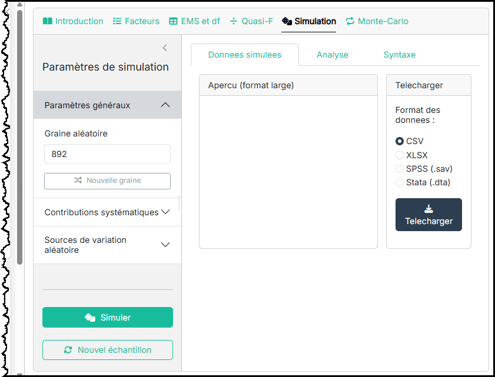{#fig-simulation}

Le sous-onglet **Données simulées**, vide au départ,, accueillera les données produites à partir du modèle spécifié.

L'interface est composée de deux parties complémentaires (figure @fig-simulation).

- Une **barre latérale**, située à gauche de l'écran, regroupe tous les paramètres nécessaires à la génération d'un nouvel échantillon. L'utilisateur y définit notamment la graine aléatoire, les contributions systématiques des effets fixes et les différentes composantes de variance avant de lancer la simulation.

Par exemple, pour le plan **A, B, c, s(A)**, les effets **A**, **B** et **AB** correspondent aux **contributions systématiques** du modèle. Ils représentent les différences moyennes entre les niveaux des facteurs et sont fixés à **0** par défaut, ce qui correspond à l'hypothèse nulle. Leur valeur peut ensuite être augmentée afin de simuler des effets de différentes amplitudes.

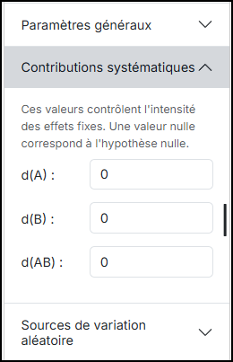{#fig-contribSys}

Ce plan comporte également plusieurs **sources de variation aléatoire** : le facteur **c**, les interactions impliquant ce facteur (**Ac**, **Bc** et **ABc**), ainsi que les différents termes d'erreur. Chacune de ces composantes est associée à une variance qui contrôle l'importance de la variabilité introduite dans les données simulées. Par défaut, toutes ces composantes sont fixées à **0**, à l'exception de la **variance résiduelle**, dont la valeur initiale est égale à **1**.

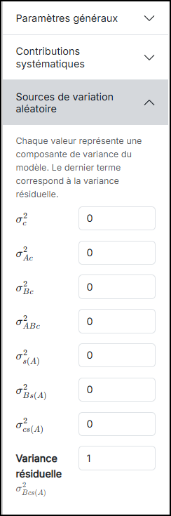{#fig-contribRand}

La spécification par défaut correspond donc à une situation où **aucun effet systématique ni aucune source de variation aléatoire supplémentaire** n'ont été introduits dans le modèle. Seule la variance résiduelle contribue à la dispersion des observations. En modifiant progressivement les tailles d'effet et les composantes de variance, il devient possible de simuler une grande variété de situations expérimentales et d'étudier leur influence sur les résultats de l'analyse.

Une fois les paramètres du modèle spécifiés, le bouton **Simuler** lance la génération d'un premier jeu de données. Le bouton **Nouvel échantillon** produit ensuite une nouvelle réalisation de la même population simulée, en conservant exactement les mêmes paramètres. Les données générées apparaissent alors dans le tableau principal (figure @fig-dataset).

En activant ces boutons, on remarquera que modifier les tailles d'effet ou les composantes de variance change la population simulée. De plus, utiliser **Nouvel échantillon** sans modifier ces paramètres produit simplement une autre réalisation de cette même population.

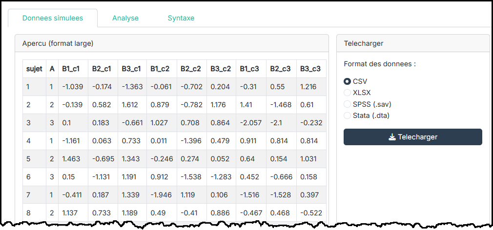{#fig-dataset}

Dès lors, on pourra télécharger les données en différents formats pour analyses à l'aide de SPSS, Stata, Excel ou autres.  

Il est important de distinguer les paramètres de génération, qui décrivent la population simulée, des données observées, qui ne représentent qu'un seul échantillon provenant de cette population. Deux échantillons générés à partir des mêmes paramètres ne seront donc jamais parfaitement identiques, tout comme deux études réelles portant sur une même population ne produisent jamais exactement les mêmes observations.

Cette comparaison constante entre les paramètres de génération et les résultats observés constitue l'un des principaux intérêts pédagogiques de la simulation.

L'application permet ainsi de modifier un seul paramètre à la fois — une taille d'effet, une composante de variance ou le nombre d'observations — afin d'observer directement son influence sur les résultats statistiques. Cette approche expérimentale favorise le développement d'une intuition des plans d'expérience qu'il serait difficile d'acquérir par la seule étude des formules.

::: {.callout-tip}
### Activité 5.1 — Faire une première simulation

Ouvrez l'onglet **Simulation**.

Choisissez un plan simple, par exemple :

`A, s(A)`

Conservez les paramètres proposés par défaut.

Avant de lancer la simulation, posez-vous les questions suivantes.

- Quels effets devraient être significatifs?
- Les données seront-elles parfaitement identiques d'une simulation à l'autre?
- Les résultats seront-ils exactement ceux attendus?

Conservez vos réponses. Vous y reviendrez après les premières simulations.
:::

::: {.callout-tip}
### Activité 5.2 — Observer la variabilité

Lancez plusieurs simulations successives sans modifier les paramètres.

Comparez les différents jeux de données obtenus.

Les observations sont-elles identiques?

Les moyennes changent-elles légèrement?

Les conclusions statistiques demeurent-elles toujours les mêmes?
:::

### Sous-onglet **Analyse**

Une fois les données générées, le sous-onglet **Analyse** permet de les examiner de façon progressive. Les résultats sont répartis en plusieurs sous-onglets qui correspondent aux principales étapes d'une analyse de la variance : production du tableau ANOVA, rappel des EMS théoriques, calcul des quasi-$F$ observés, vérification des postulats, exploration graphique et interprétation des résultats.

Les paramètres de simulation demeurent accessibles tout au long de cette étape. Il est donc possible de modifier les tailles d'effet ou les composantes de variance, de générer un nouvel échantillon, puis d'observer immédiatement les conséquences de ces changements sur les résultats de l'analyse. Par exemple, on pourra d'abord simuler des données sous l'hypothèse nulle, puis introduire progressivement un ou l'aoutre, ou une combinaison d'effets afin d'en étudier l'influence sur le tableau ANOVA.

#### Sous-onglet **Tableau ANOVA**

La première étape de l'analyse consiste à produire le tableau ANOVA (voir @fig-anova). Celui-ci reprend les composantes classiques d'une analyse de la variance : les sources de variation, les sommes des carrés ($SS$), les degrés de liberté ($df$), les carrés moyens ($MS$), les statistiques $F$ et leurs probabilités associées ($p$).

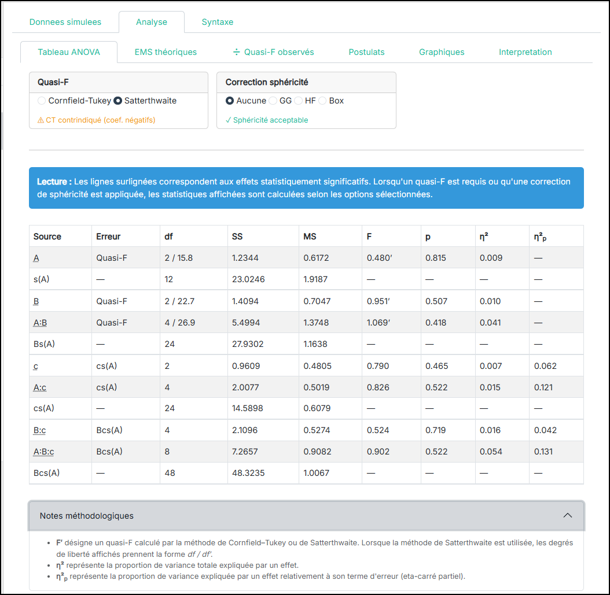{#fig-anova}

L'application ajoute également plusieurs informations utiles à l'interprétation. Lorsqu'un quasi-$F$ est nécessaire, le terme d'erreur utilisé est indiqué explicitement et les degrés de liberté sont ajustés selon la méthode retenue (Cornfield–Tukey ou Satterthwaite). 

Lorsque le plan comporte des facteurs à mesures répétées, différentes corrections de sphéricité peuvent être appliquées via le menu **Correction sphéricité**. L'utilisateur peut sélectionner la méthode souhaitée : **GG** (Greenhouse–Geisser), **HF** (Huynh–Feldt) ou **Box** (Borne inférieure). 

Pour rappel, ces corrections s'appliquent exclusivement aux facteurs intra-sujets. Elles modifient les degrés de liberté de la distribution $F$ en les multipliant par une estimation de l'epsilon ($\varepsilon$). Le résumé suivant présente leurs caractéristiques fondamentales :

- **Greenhouse–Geisser** : 
  - Correction très prudente et courante.
  - Recommandée lorsque l'epsilon estimé est inférieur à $0{,}75$.
  - A tendance à sous-estimer légèrement $\varepsilon$ si la sphéricité est forte.
- **Huynh–Feldt** : 
  - Correction moins conservatrice que Greenhouse–Geisser.
  - Préférée lorsque l'epsilon estimé est supérieur à $0{,}75$.
  - Peut parfois générer un $\varepsilon$ supérieur à $1$ (il est alors ramené à $1$).
- **Borne inférieure (Box / Lower-bound)** : 
  - Option la plus stricte de toutes.
  - Fixe $\varepsilon$ à sa valeur minimale possible, soit $1 / (k-1)$, où $k$ représente le nombre de conditions.
  - Souvent trop conservatrice, elle est plus rarement exploitée en pratique.

Enfin, des indices de taille d'effet ($\eta^2$ et $\eta_p^2$) complètent le tableau afin de faciliter l'interprétation pratique des résultats.

#### Sous-onglet **EMS théoriques**

Le second sous-onglet présente les **carrés moyens attendus (EMS)** calculés à partir des paramètres ayant servi à la génération des données, puis les compare aux carrés moyens réellement observés dans l'échantillon simulé. Il permet ainsi de faire directement le lien entre les résultats théoriques établis au chapitre précédent et les données effectivement générées.

L'affichage comprend trois parties. La figure suivante présente les deux premières.

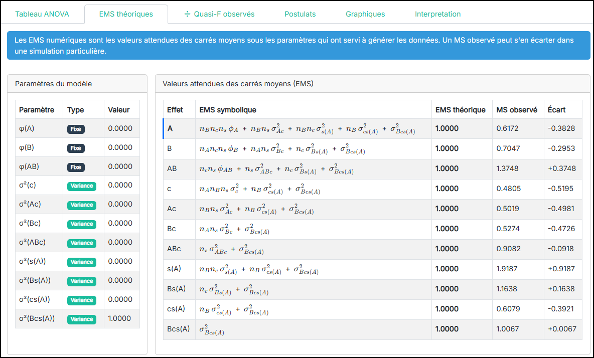

Le tableau de gauche résume les paramètres utilisés pour la simulation. On y retrouve les **contributions systématiques** (effets fixes) ainsi que les **composantes de variance** (sources de variation aléatoire) spécifiées dans la barre latérale.

Le tableau de droite présente, pour chacun des effets du modèle, l'expression symbolique de son EMS, sa valeur théorique, le carré moyen observé dans l'échantillon simulé ainsi que l'écart entre ces deux valeurs. En moyenne, les carrés moyens observés devraient converger vers leur espérance théorique. Pour un seul échantillon, toutefois, de légères différences sont normales puisqu'elles résultent de la variabilité d'échantillonnage.

Le troisième tableau, replié par défaut, présente la décomposition détaillée de l'EMS associé à un effet sélectionné dans la liste située au-dessus. La figure suivante illustre cette décomposition pour l'interaction **AB**.

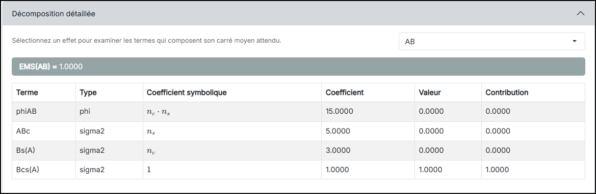

Cette présentation détaillée permet de retrouver chacune des composantes intervenant dans l'EMS, leur coefficient et leur contribution à la valeur théorique du carré moyen attendu. Elle constitue un excellent complément au chapitre consacré aux EMS, puisqu'elle montre concrètement comment les expressions théoriques sont utilisées lors de l'analyse des données simulées.

#### Sous-onglet **Quasi-$F$ observés**

Le chapitre précédent a montré comment construire un quasi-$F$ lorsqu'aucun terme d'erreur pur ne permet de tester directement un effet. Cette construction reposait toutefois sur les **espérances des carrés moyens (EMS)**, c'est-à-dire sur des quantités théoriques.

Lors d'une analyse réelle, les EMS ne sont jamais observés. Ils doivent être remplacés par les **carrés moyens calculés à partir des données**. Le sous-onglet **Quasi-$F$ observés** reprend exactement le raisonnement développé au chapitre précédent et montre comment celui-ci est appliqué à un échantillon simulé.

Afin de rendre cette démarche aussi transparente que possible, l'application décompose le calcul du quasi-$F$ en cinq étapes successives. Chacune correspond à une partie précise du raisonnement, depuis l'identification des carrés moyens jusqu'à la décision statistique finale.

##### Étape 1 — Les carrés moyens observés

La première étape consiste à identifier tous les carrés moyens intervenant dans la construction du quasi-$F$ (figure @fig-quasi1).

Pour chacun d'eux, l'application indique :

- sa valeur observée;
- ses degrés de liberté;
- son coefficient dans la combinaison de Cornfield–Tukey;
- son rôle dans le calcul (effet testé, numérateur, dénominateur ou terme transféré).

Cette première étape établit donc la liste complète des quantités qui seront utilisées dans les calculs subséquents.

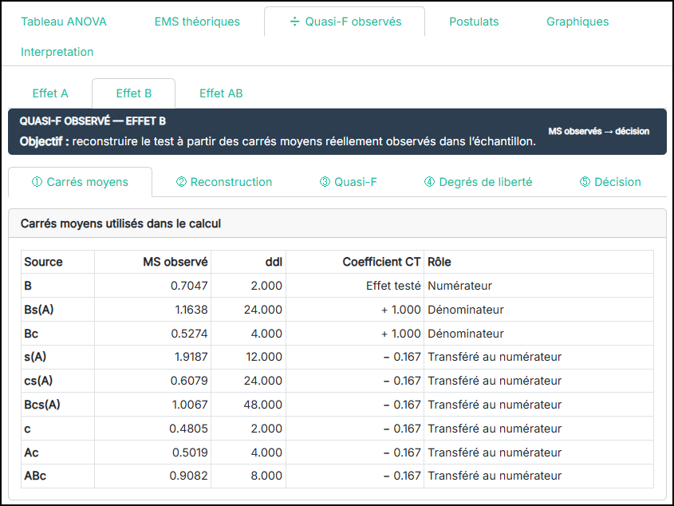{#fig-quasi1}

##### Étape 2 — Reconstruction des combinaisons

Cette étape constitue le cœur du calcul (figure @fig-quasi2).

L'application rappelle d'abord l'expression complète de l'EMS associé à l'effet étudié. Sous l'hypothèse nulle, la contribution propre de cet effet disparaît de cette expression. Il faut alors construire deux combinaisons de carrés moyens possédant exactement la même espérance.

La méthode de Cornfield–Tukey détermine automatiquement ces deux combinaisons. Les termes possédant un coefficient négatif dans le dénominateur théorique sont transférés au numérateur afin d'obtenir deux combinaisons positives de carrés moyens.

Les espérances théoriques sont ensuite remplacées par les carrés moyens réellement observés dans l'échantillon. On obtient ainsi les deux quantités numériques qui serviront à calculer le quasi-$F$.

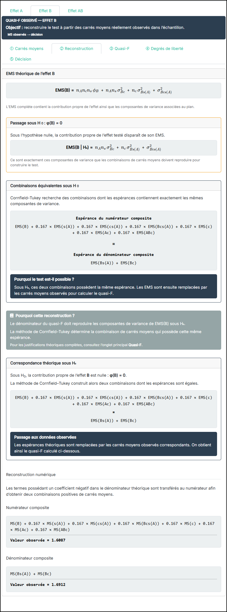{#fig-quasi2}

##### Étape 3 — Calcul du quasi-$F$

Les deux combinaisons obtenues à l'étape précédente deviennent le numérateur et le dénominateur du quasi-$F$ (figure @fig-quasi3).

L'application calcule automatiquement leur rapport afin d'obtenir la statistique observée.

Cette étape correspond exactement au calcul effectué dans le tableau ANOVA; elle en montre simplement tous les détails.

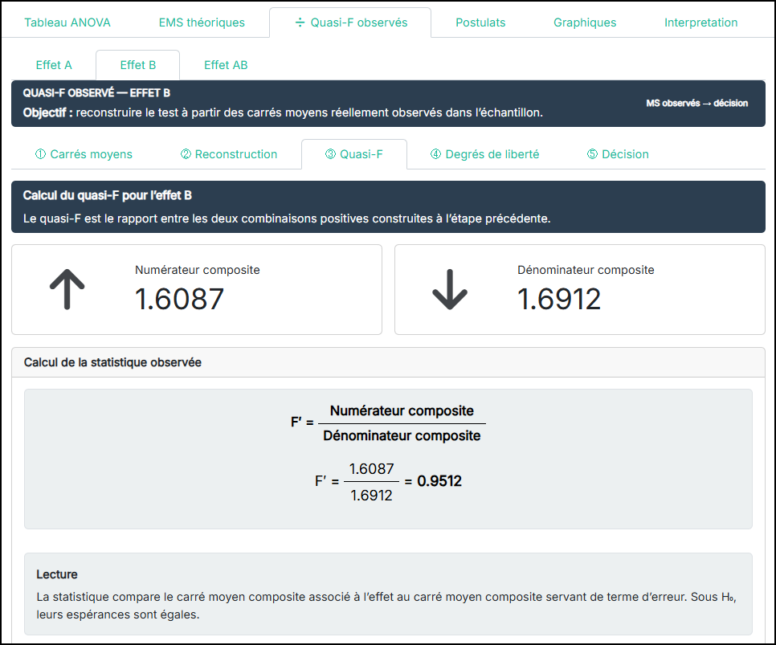{#fig-quasi3}

##### Étape 4 — Approximation des degrés de liberté

Le numérateur et le dénominateur du quasi-$F$ étant chacun constitués d'une combinaison de plusieurs carrés moyens, ils ne possèdent plus les degrés de liberté d'un seul carré moyen.

L'application applique alors automatiquement l'approximation de Satterthwaite afin d'obtenir les deux degrés de liberté effectifs associés au quasi-$F$ (figure @fig-quasi4).

Ces degrés de liberté sont généralement non entiers. Ils représentent les degrés de liberté équivalents des deux combinaisons utilisées dans le calcul.

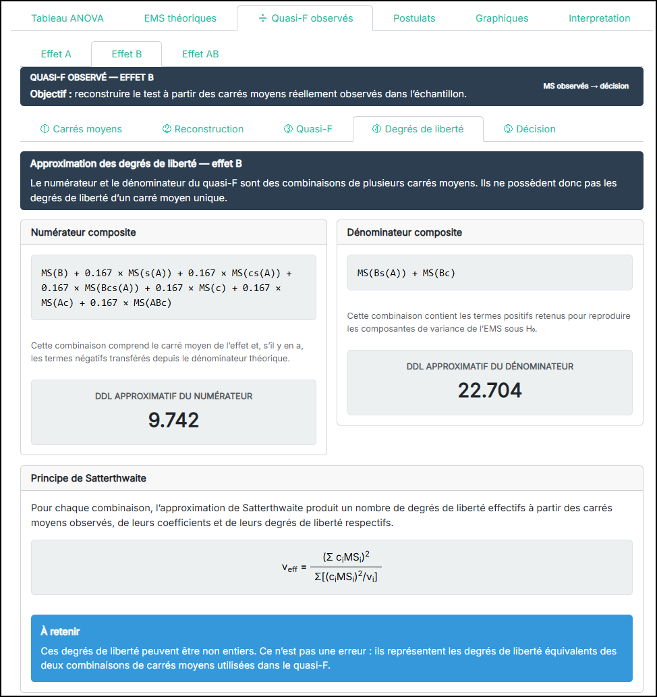{#fig-quasi4}

##### Étape 5 — Décision statistique

La dernière étape consiste à comparer le quasi-$F$ observé à une loi $F$ utilisant les degrés de liberté calculés à l'étape précédente (figure @fig-quasi5).

L'application présente simultanément la valeur du quasi-$F$, ses degrés de liberté, la probabilité associée ($p$), la décision statistique ainsi qu'une interprétation textuelle des résultats.

L'étudiant peut ainsi suivre l'ensemble du raisonnement, depuis les carrés moyens observés jusqu'à la conclusion finale du test.

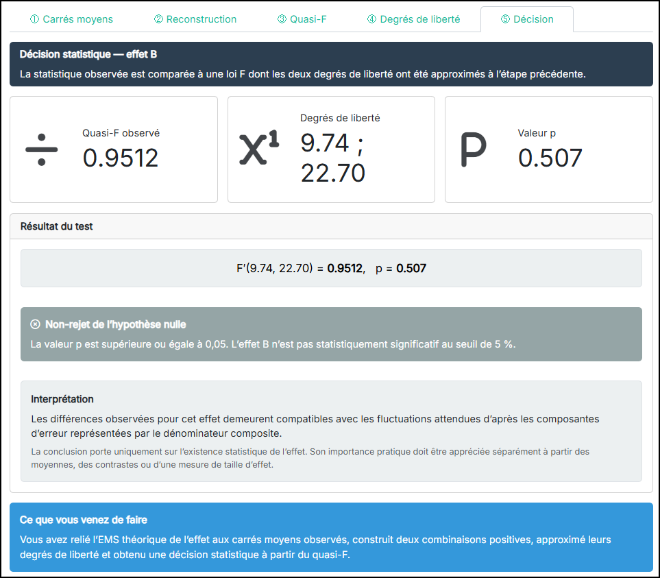{#fig-quasi5}

::: {.callout-tip}
## Ce qu'il faut retenir

Le sous-onglet **Quasi-$F$ observés** ne constitue pas une nouvelle méthode d'analyse. Il montre, étape par étape, comment le quasi-$F$ présenté dans le tableau ANOVA est construit à partir des carrés moyens observés dans l'échantillon.

Il établit ainsi un lien direct entre les développements théoriques du chapitre précédent et les calculs effectivement réalisés lors de l'analyse des données.
:::

#### Sous-onglet **Postulats**

Avant d'interpréter les résultats d'une analyse de la variance, il est recommandé de vérifier que les principaux postulats du modèle sont raisonnablement respectés. Le sous-onglet **Postulats** rassemble les principaux tests utilisés à cette fin et fournit une interprétation automatique de leurs résultats.

Dans la version actuelle de l'application, les données sont générées de manière à satisfaire ces postulats. Les tests présentés servent donc essentiellement à illustrer leur interprétation. Comme ils sont appliqués à un échantillon simulé, un résultat significatif peut néanmoins survenir occasionnellement en raison de la fluctuation d'échantillonnage.

La figure @fig-postulats illustre les deux principales vérifications effectuées.

{#fig-postulats}

- **Le test de Levene** évalue l'homogénéité des variances entre les groupes définis par les facteurs inter-sujets. Une valeur $p$ élevée indique que les différences observées entre les variances sont compatibles avec la variabilité d'échantillonnage et que l'hypothèse d'homogénéité peut être conservée.

- **Le test de Mauchly** vérifie le postulat de sphéricité pour les facteurs intra-sujets. Lorsque ce test est significatif, l'application propose les principales corrections classiques (Greenhouse–Geisser, Huynh–Feldt et Box) afin d'ajuster les degrés de liberté des tests $F$.

Dans chaque cas, l'application ne se limite pas à présenter les statistiques de test. Elle fournit également une interprétation textuelle permettant de comprendre immédiatement si le postulat est considéré comme satisfait et quelles en sont les conséquences pour l'analyse.

::: {.callout-note}
### À retenir

Les tests de Levene et de Mauchly portent sur des **échantillons** et non sur la population. Même lorsque les données sont simulées de manière à respecter les postulats, un résultat significatif peut occasionnellement être obtenu en raison des fluctuations d'échantillonnage. C'est précisément cette variabilité que l'application permet d'observer.
:::

#### Sous-onglet **Graphiques**

Les tableaux de résultats permettent de déterminer quels effets sont statistiquement significatifs. Les graphiques complètent cette information en offrant une représentation visuelle des données simulées et des relations entre les facteurs.

Le sous-onglet **Graphiques** propose deux types de représentations complémentaires :

- **les distributions des observations**, présentées sous forme de boîtes à moustaches, permettent d'évaluer la dispersion des données, leur variabilité et la présence éventuelle de valeurs atypiques;
- **les profils des moyennes**, accompagnés de leurs barres d'erreur, facilitent l'interprétation des effets principaux et des interactions en mettant directement en évidence les différences entre les groupes.

Les variables utilisées sur l'axe horizontal, pour les couleurs et pour les facettes peuvent être modifiées dynamiquement au moyen des options situées dans la barre latérale. Les graphiques s'adaptent ainsi automatiquement à la structure du plan d'expérience et aux facteurs que l'utilisateur souhaite comparer.

:::: {.columns}

::: {.column width="50%"}

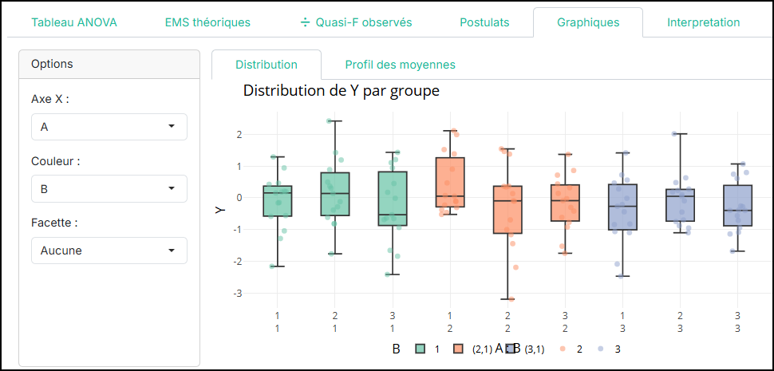{#fig-distribution}

:::

::: {.column width="50%"}

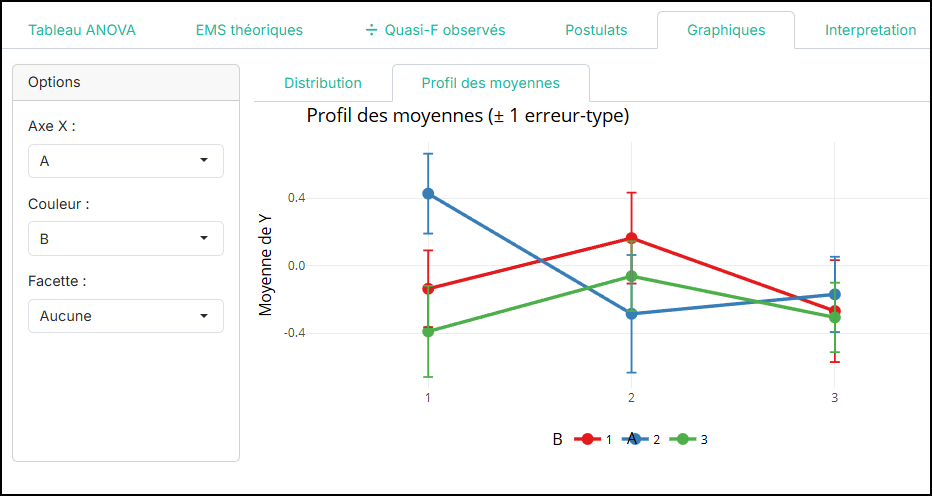{#fig-profils}

:::

::::

#### Sous-onglet **Interprétation**

Le dernier sous-onglet regroupe les principaux résultats de l'analyse sous une forme synthétique et entièrement rédigée. Son objectif est de faciliter l'interprétation des résultats sans que l'utilisateur ait à consulter successivement le tableau ANOVA, les quasi-$F$ ou les différents indicateurs statistiques.

La figure @fig-interpretation montre les deux parties principales de ce sous-onglet.

La section **Diagnostic automatique** résume d'abord les caractéristiques générales de l'analyse : type de plan d'expérience, nombre d'effets testés, nombre d'effets statistiquement significatifs, méthode utilisée pour les quasi-$F$ ainsi que la correction de sphéricité appliquée, le cas échéant. Un court diagnostic met ensuite immédiatement en évidence le résultat principal de l'analyse.

La seconde partie présente une **interprétation détaillée de chacun des effets** du modèle. Chaque effet apparaît dans un panneau replié par défaut afin de faciliter la navigation lorsque le plan d'expérience comporte de nombreuses sources de variation.

Pour chaque effet, l'application rappelle notamment :

- la statistique de test retenue;
- les degrés de liberté utilisés;
- la valeur $p$ obtenue;
- la méthode employée (test $F$ classique ou quasi-$F$);
- une interprétation rédigée automatiquement du résultat.

Cette présentation permet de passer directement des résultats numériques à leur interprétation statistique, tout en conservant l'ensemble des informations nécessaires à la rédaction d'un rapport d'analyse.

{#fig-interpretation}

::: {.callout-tip}
### À retenir

L'interprétation générée par l'application constitue une aide à l'analyse et à la rédaction des résultats. Elle ne remplace pas le jugement du chercheur, qui doit toujours replacer les résultats statistiques dans le contexte scientifique de son étude.
:::

::: {.callout-tip}
### Activité 5.3 — Modifier un seul paramètre

Choisissez un effet du modèle.

Augmentez progressivement sa taille tout en laissant tous les autres paramètres inchangés.

Après chaque simulation, observez :

- les graphiques;
- les statistiques $F$;
- les valeurs de *p*;
- les tailles d'effet.

Comment ces résultats évoluent-ils lorsque l'effet devient de plus en plus important?
:::

### Conclusion

Ce chapitre a montré comment passer d'un plan d'expérience théorique à un jeu de données simulées conforme aux paramètres choisis. Une fois les données générées, l'application réalise automatiquement l'ensemble des analyses nécessaires : tableau ANOVA, EMS, quasi-$F$, vérification des postulats, représentations graphiques et interprétation des résultats.

Le chapitre suivant franchit une étape supplémentaire. Au lieu d'étudier un seul échantillon simulé, il répète automatiquement cette démarche des centaines ou des milliers de fois afin d'évaluer expérimentalement les propriétés des tests statistiques au moyen de simulations Monte-Carlo.

