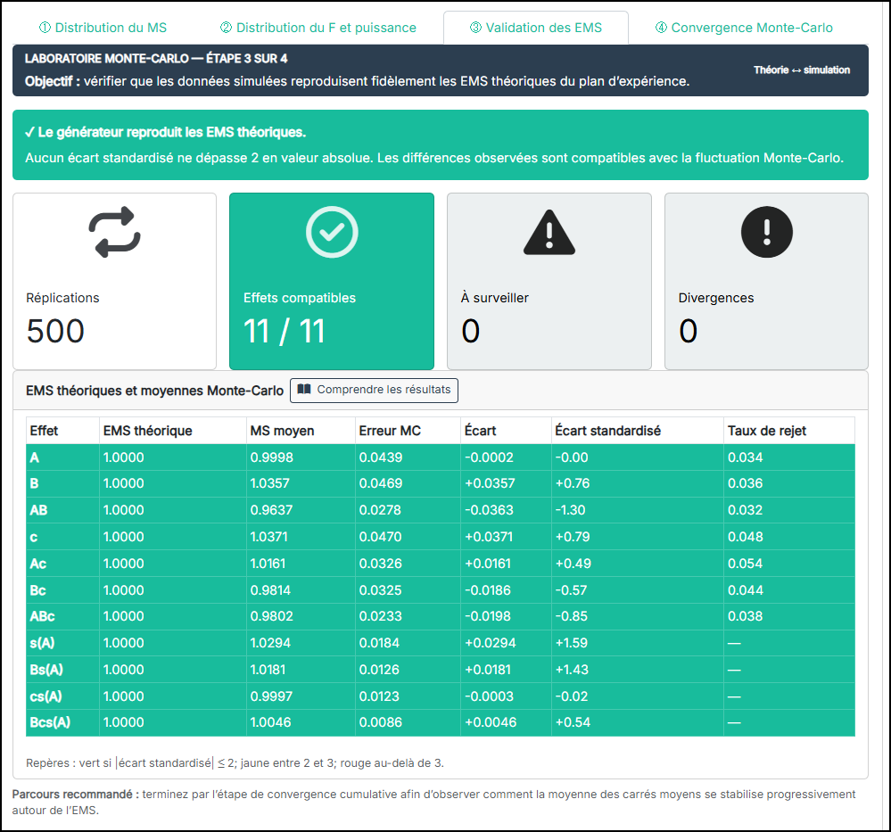
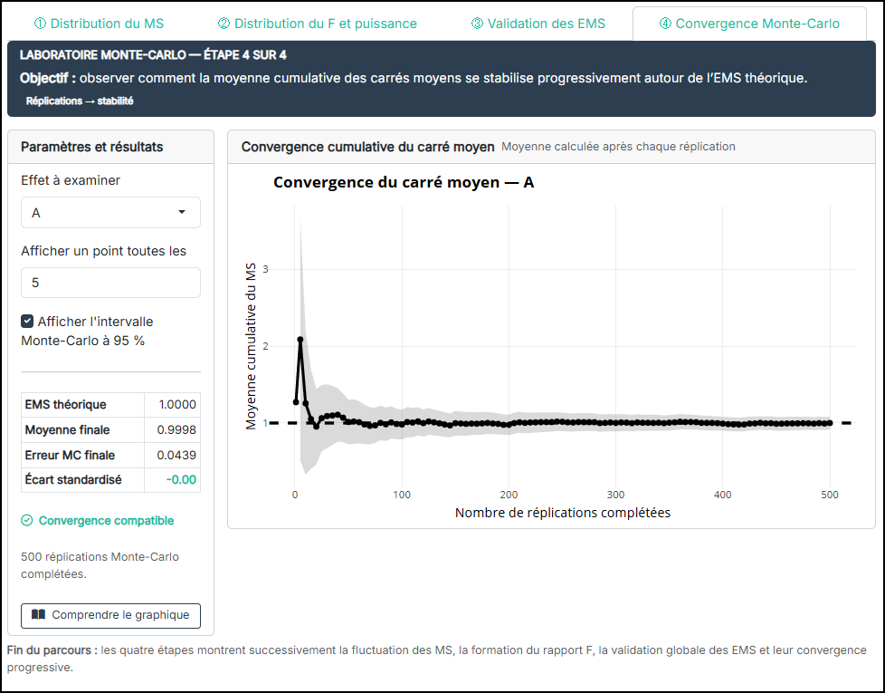

# Chapitre 6 — Le laboratoire Monte-Carlo

::: {.callout-note}
### Dans l'application

Cette section correspond à l'onglet **Monte-Carlo**.
:::

## Pourquoi répéter des simulations?

Le chapitre précédent montrait comment générer **un seul échantillon** à partir d'une population dont tous les paramètres sont connus. Cet échantillon était ensuite analysé exactement comme le seraient des données provenant d'une étude réelle.

Une seule analyse ne permet toutefois pas d'évaluer les propriétés d'une méthode statistique. Les résultats observés dépendent toujours, en partie, de la fluctuation d'échantillonnage. Un effet peut être déclaré significatif ou non simplement parce qu'un échantillon particulier a été obtenu.

Pour comprendre le comportement d'une méthode statistique, il faut répéter la même expérience un grand nombre de fois dans des conditions identiques et étudier l'ensemble des résultats obtenus.

C'est précisément le principe des **simulations Monte-Carlo**.

Au lieu de générer un seul échantillon, l'application en produit automatiquement des centaines ou des milliers. Chaque échantillon est analysé, puis les résultats sont regroupés afin d'étudier expérimentalement le comportement des carrés moyens, des rapports $F$, des probabilités de rejet et des espérances des carrés moyens.

Le laboratoire Monte-Carlo est organisé comme une démarche progressive composée de quatre étapes. Chacune répond à une question particulière et prépare naturellement la suivante.

## Le laboratoire Monte-Carlo

L'interface du laboratoire est volontairement très simple (figure @fig-mc-sidebar). Les paramètres de la population ayant déjà été définis dans l'onglet **Simulation**, il suffit ici de préciser le nombre de réplications désiré ainsi que la graine aléatoire, puis de lancer les simulations.

Le panneau supérieur rappelle également le **parcours recommandé**, constitué de quatre activités conçues pour être réalisées dans l'ordre.

{#fig-mc-sidebar}

Les sections suivantes décrivent successivement chacune de ces quatre étapes.

## Distribution du carré moyen

La première activité du laboratoire Monte-Carlo répond à une question fondamentale : **pourquoi un carré moyen observé n'est-il jamais exactement égal à son espérance théorique (EMS)?**

Dans les chapitres précédents, les EMS étaient présentés comme des quantités théoriques calculées à partir de la structure du plan d'expérience et des paramètres de la population. Les carrés moyens obtenus lors d'une analyse de variance correspondent toutefois à des estimations calculées à partir d'un seul échantillon. Ils sont donc soumis à la fluctuation d'échantillonnage.

L'application répète ici un grand nombre de simulations indépendantes. À chaque réplication, un nouvel échantillon est généré à partir de la même population, puis le carré moyen associé à l'effet sélectionné est calculé. L'ensemble de ces valeurs forme une distribution empirique qui peut être comparée directement à son EMS théorique.

{#fig-mc-ms}

Le panneau de gauche résume les principaux résultats obtenus. Il présente notamment :

- l'EMS théorique de l'effet sélectionné;
- la moyenne des carrés moyens observés;
- l'erreur Monte-Carlo;
- l'écart entre la moyenne simulée et la valeur théorique;
- un diagnostic automatique de convergence.

Le graphique montre que les carrés moyens observés présentent une variabilité parfois importante d'un échantillon à l'autre. Cette variabilité est normale et ne traduit pas une erreur de simulation. En revanche, lorsque le nombre de réplications est suffisamment élevé, la **moyenne** de ces carrés moyens se rapproche progressivement de leur espérance théorique.

Cette première étape illustre donc expérimentalement une propriété fondamentale de l'analyse de la variance : **un carré moyen individuel peut s'écarter sensiblement de son EMS, mais la moyenne d'un grand nombre de carrés moyens converge vers cette valeur théorique.**

::: {.callout-tip}
### À retenir

Un EMS représente une **espérance théorique**, et non la valeur que prendra un carré moyen dans un échantillon particulier. Les simulations Monte-Carlo montrent que les carrés moyens fluctuent naturellement d'un échantillon à l'autre, mais que leur moyenne converge progressivement vers l'EMS lorsque le nombre de réplications augmente.
:::
  
## Distribution du rapport $F$ et puissance

La deuxième activité prolonge directement la précédente. Si les carrés moyens fluctuent d'un échantillon à l'autre, leur rapport fluctue également. Or, c'est précisément ce rapport qui constitue la statistique $F$ utilisée dans l'analyse de la variance.

À chaque réplication Monte-Carlo, l'application calcule le rapport $F$ correspondant à l'effet sélectionné. L'ensemble de ces valeurs forme une distribution empirique qui peut être comparée à la loi théorique de Fisher attendue sous l'hypothèse nulle.

{#fig-mc-f}

Le panneau de gauche présente les principaux résultats de la simulation :

- les degrés de liberté du numérateur et du dénominateur;
- la valeur critique du test au seuil choisi;
- la moyenne et la médiane des rapports $F$ observés;
- le taux de rejet obtenu au cours des simulations.

Le graphique représente la distribution empirique des rapports $F$. Lorsque l'option appropriée est sélectionnée, la densité théorique de la loi $F$ est également superposée, ce qui permet de comparer directement les résultats simulés aux propriétés théoriques du test.

La ligne verticale en pointillés indique la valeur critique du test, tandis que la région ombrée correspond à la zone de rejet de l'hypothèse nulle. Chaque rapport $F$ situé dans cette région conduit à une décision de rejet.

Lorsque les données sont simulées sous $H_0$, la proportion de rapports $F$ qui franchissent cette limite constitue une estimation expérimentale de **l'erreur de type I**. En revanche, lorsqu'un effet réel est introduit dans la population simulée, cette même proportion devient une estimation de la **puissance statistique** du test.

Cette activité montre ainsi que les probabilités de rejet ne résultent pas d'une formule abstraite, mais émergent directement de la distribution des statistiques $F$ obtenues sur un grand nombre d'échantillons indépendants.

::: {.callout-tip}
### À retenir

Le rapport $F$ est lui aussi une variable aléatoire. Les simulations Monte-Carlo permettent d'observer directement sa distribution, d'illustrer la notion de région critique et d'estimer expérimentalement aussi bien l'erreur de type I que la puissance d'un test.
:::

## Validation des EMS

La troisième activité constitue une validation expérimentale de l'ensemble du générateur de données. Son objectif est de vérifier que les carrés moyens obtenus au cours des simulations reproduisent fidèlement les **espérances des carrés moyens (EMS)** construites à partir du modèle théorique.

Pour chaque source de variation du plan d'expérience, l'application compare la moyenne des carrés moyens obtenus lors des réplications Monte-Carlo à l'EMS correspondant. Si le générateur est correct et que le nombre de réplications est suffisant, ces deux valeurs devraient être très proches.

{#fig-mc-validation}

Le tableau principal présente, pour chacun des effets du modèle :

- l'EMS théorique;
- la moyenne des carrés moyens observés;
- l'erreur Monte-Carlo;
- l'écart entre les deux valeurs;
- l'écart standardisé;
- le taux de rejet obtenu lorsque l'effet est testé.

L'écart standardisé constitue le principal indicateur de validation. Il exprime la différence entre la moyenne Monte-Carlo et l'EMS théorique relativement à l'erreur Monte-Carlo attendue. Lorsque cette quantité demeure faible en valeur absolue, les différences observées sont compatibles avec les fluctuations normales d'échantillonnage.

Le tableau de bord situé au haut de la fenêtre résume automatiquement les résultats de cette validation. Il indique le nombre de réplications réalisées, le nombre d'effets compatibles avec les valeurs théoriques ainsi que les éventuelles divergences nécessitant une attention particulière.

Cette étape constitue une vérification globale de l'application. Elle montre que les données simulées reproduisent correctement les propriétés théoriques du plan d'expérience et que les analyses réalisées dans les chapitres précédents sont cohérentes avec les espérances mathématiques des carrés moyens.

::: {.callout-tip}
### À retenir

Les EMS sont des résultats théoriques. Les simulations Monte-Carlo permettent de vérifier expérimentalement que les moyennes des carrés moyens observés convergent bien vers ces valeurs lorsque les réplications sont suffisamment nombreuses. Cette concordance constitue une validation du générateur de données et de l'ensemble des calculs effectués par l'application.
:::

## Convergence Monte-Carlo

La dernière activité du laboratoire permet d'observer directement un phénomène fondamental des simulations Monte-Carlo : **la convergence des estimations lorsque le nombre de réplications augmente**.

Les activités précédentes ont montré que les carrés moyens fluctuent naturellement d'un échantillon à l'autre. Cette variabilité est une conséquence inévitable de l'échantillonnage. En revanche, lorsque les simulations sont répétées un grand nombre de fois, ces fluctuations tendent progressivement à se compenser.

L'application calcule, après chaque réplication, la moyenne cumulative des carrés moyens observés. Cette moyenne est ensuite comparée à l'EMS théorique correspondant.

{#fig-mc-convergence}

Le graphique présente l'évolution de cette moyenne cumulative. Les premières simulations produisent généralement des fluctuations importantes, puisqu'elles reposent sur un très petit nombre d'échantillons. Au fil des réplications, ces fluctuations diminuent progressivement et la courbe se stabilise autour de la valeur théorique attendue.

Cette convergence constitue une illustration directe de la **loi des grands nombres**. Bien que chaque carré moyen individuel demeure aléatoire, la moyenne d'un nombre croissant de réplications devient de plus en plus stable et se rapproche de son espérance.

Le tableau situé sous le graphique résume les principaux indicateurs de convergence. Il permet notamment d'examiner :

- le nombre de réplications réalisées;
- la moyenne cumulative obtenue;
- l'EMS théorique;
- l'écart entre ces deux valeurs;
- les principaux indicateurs de précision de la simulation.

Cette dernière activité montre qu'une simulation Monte-Carlo ne repose pas sur une seule réalisation, mais sur l'accumulation d'un grand nombre d'expériences indépendantes. Plus le nombre de réplications augmente, plus les estimations obtenues deviennent précises et plus les conclusions tirées des simulations sont fiables.

::: {.callout-tip}
### À retenir

Une simulation Monte-Carlo ne cherche pas à obtenir un « bon » échantillon. Elle exploite au contraire la variabilité naturelle entre un grand nombre d'échantillons indépendants afin d'estimer expérimentalement les propriétés d'une méthode statistique. La précision de ces estimations augmente progressivement avec le nombre de réplications.
:::

## Conclusion

Les simulations Monte-Carlo constituent l'aboutissement naturel de la démarche développée tout au long de cet ouvrage. Après avoir appris à construire un plan d'expérience, à établir les espérances des carrés moyens, à déterminer les quasi-$F$ appropriés et à analyser un premier jeu de données simulées, le lecteur est maintenant en mesure de vérifier expérimentalement les propriétés de ces méthodes.

Cette approche illustre l'un des principaux intérêts de la simulation en statistique. Les résultats théoriques ne sont plus seulement démontrés : ils peuvent être observés, reproduits et validés expérimentalement. L'utilisateur peut ainsi modifier librement les paramètres du modèle, répéter les simulations autant de fois qu'il le souhaite et développer une intuition approfondie du comportement des analyses de la variance.

Au terme de ce parcours, l'application ne se limite plus à un simple outil de calcul. Elle devient un véritable **laboratoire expérimental**, où les propriétés des méthodes statistiques peuvent être explorées, comprises et vérifiées à partir de populations dont tous les paramètres sont connus.

L'objectif de cette application n'est pas seulement de produire des analyses de variance, mais de permettre au lecteur d'en comprendre les fondements, d'en observer expérimentalement les propriétés et de développer une intuition des méthodes qui dépasse la simple application des formules.

::: {.callout-note}
### Les simulations ne remplacent pas les démonstrations

Les simulations Monte-Carlo permettent de vérifier expérimentalement les propriétés d'une méthode statistique, mais elles ne constituent pas une démonstration mathématique.

Elles fournissent plutôt une confirmation empirique des résultats théoriques développés dans les chapitres précédents.
:::

::: {.callout-tip}
### Activité 6.5 — Vérifier expérimentalement une hypothèse

Choisissez un plan d'expérience simple.

1. Simulez des données sous $H_0$.
2. Lancez 5000 réplications Monte-Carlo.
3. Notez le taux de rejet obtenu.
4. Introduisez ensuite un effet fixe.
5. Relancez exactement les mêmes simulations.

Comparez les distributions des rapports $F$, les taux de rejet et les conclusions obtenues.

Cette expérience illustre directement la différence entre le niveau nominal d'un test et sa puissance statistique.
:::
