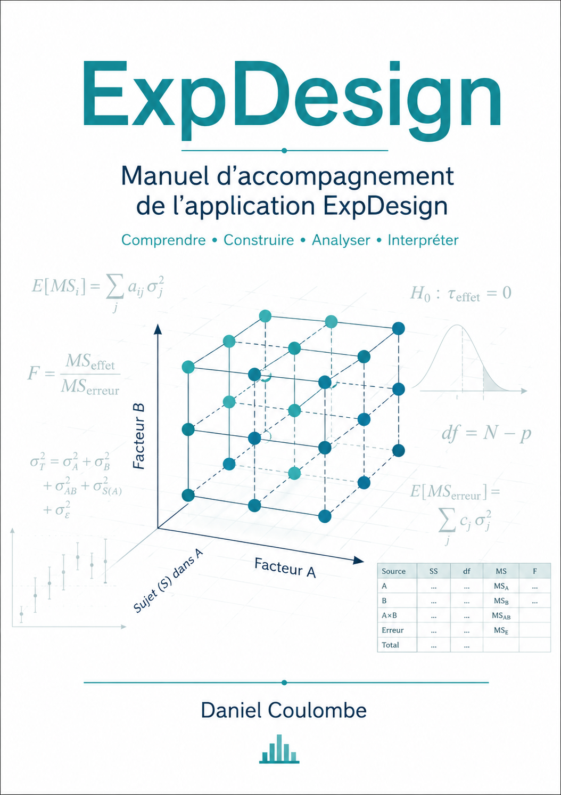

::: {.content-hidden when-format="epub"}

::: {.content-visible when-format="html"}

{fig-align="center" width="78%"}

:::

:::

# Préface {.unnumbered}

Une analyse de variance commence bien avant le calcul d'une statistique. Elle prend forme dans la manière dont les observations sont recueillies : les traitements appliqués, les unités auxquelles ils sont attribués, les facteurs étudiés et les relations qui les unissent. Comprendre un plan d'expérience, c'est donner un sens à cette organisation pour savoir quelles comparaisons elle autorise et quelle portée accorder aux conclusions.

Une question traverse ainsi cet ouvrage : **à quelle variation faut-il comparer l'effet que l'on souhaite étudier ?** Un rapport $F$ paraît simple lorsqu'il est écrit sous la forme d'un quotient de carrés moyens. La difficulté consiste à comprendre ce que représentent ces deux quantités et pourquoi leur comparaison permet de mettre une hypothèse à l'épreuve. Le choix du terme d'erreur devient alors une question de raisonnement, intimement liée à la structure du plan.

Ce manuel propose de rendre ce raisonnement accessible. Les facteurs fixes ou aléatoires, les relations de croisement ou d'imbrication et les mesures répétées expriment des différences dans l'organisation des observations et dans les questions auxquelles on cherche à répondre. Les reconnaître permet de comprendre pourquoi une modification du plan peut changer le modèle, les sources de variation pertinentes et la construction des tests.

Les espérances des carrés moyens, désignées dans cet ouvrage par l'abréviation EMS, occupent une place centrale dans cette démarche. Elles relient la description du plan à la logique de l'analyse. Leur étude permet d'examiner ce que chaque carré moyen mesure en moyenne, de justifier les rapports $F$ et de comprendre pourquoi certains plans nécessitent la construction d'un quasi-$F$. Les développements mathématiques prennent ainsi leur sens dans une question que le lecteur a d'abord appris à formuler.

L'application **ExpDesign** accompagne cette progression en offrant un espace d'exploration. Le lecteur peut décrire un plan, examiner ses conséquences théoriques, préciser les paramètres d'une population simulée et analyser les données qui en sont issues. Le manuel fournit les explications nécessaires pour interpréter ces résultats ; l'application permet de les mettre à l'épreuve et de revenir au texte avec de nouvelles questions.

La simulation invite aussi à distinguer les propriétés du modèle et les résultats d'un échantillon particulier. Une espérance théorique décrit un comportement moyen ; un carré moyen observé varie d'un échantillon à l'autre. Le laboratoire Monte-Carlo prolonge cette découverte en répétant les expériences. Il permet d'examiner la distribution des résultats, les fréquences de rejet et la convergence des moyennes simulées vers les valeurs attendues. Cette confrontation empirique éclaire la théorie, tout en conservant la distinction entre une observation numérique et une démonstration.

Pour tirer parti de cette complémentarité, nous invitons le lecteur à adopter une habitude simple : **anticiper, manipuler, puis expliquer**. Avant de modifier un facteur ou un paramètre, formuler une attente. Après la manipulation, décrire ce qui a changé et ce qui est demeuré stable. Enfin, chercher dans la structure du plan et dans les EMS une explication de ces observations. Les écarts entre l'intuition initiale et les résultats deviennent ainsi des occasions d'apprendre.

L'ouvrage s'adresse aux étudiants, aux enseignants et aux chercheurs qui souhaitent approfondir leur compréhension de l'analyse de la variance et des plans d'expérience. Une familiarité avec les notions de variance, d'hypothèse statistique et de test $F$ facilite la lecture. Les premières sections construisent progressivement le vocabulaire et le raisonnement ; les passages consacrés aux quasi-$F$ et l'annexe mathématique peuvent être repris lors d'une seconde lecture, à mesure que les questions se précisent.

Cette démarche reste attentive aux conditions qui rendent une analyse pertinente. La cohérence des calculs doit s'accompagner d'un examen du dispositif, des postulats et de la question de recherche. Les résultats d'une simulation sont interprétés dans le cadre du modèle qui les a produits, et les approximations doivent être reconnues comme telles.

L'ambition de ce manuel est de développer une autonomie de raisonnement : pouvoir décrire un plan, justifier une comparaison, interpréter un résultat et reconnaître les limites d'une conclusion. Le lecteur pourra alors aborder les différents modèles comme les expressions d'une même question : comment organiser et comprendre les sources de variation pour répondre rigoureusement à une question de recherche ?
